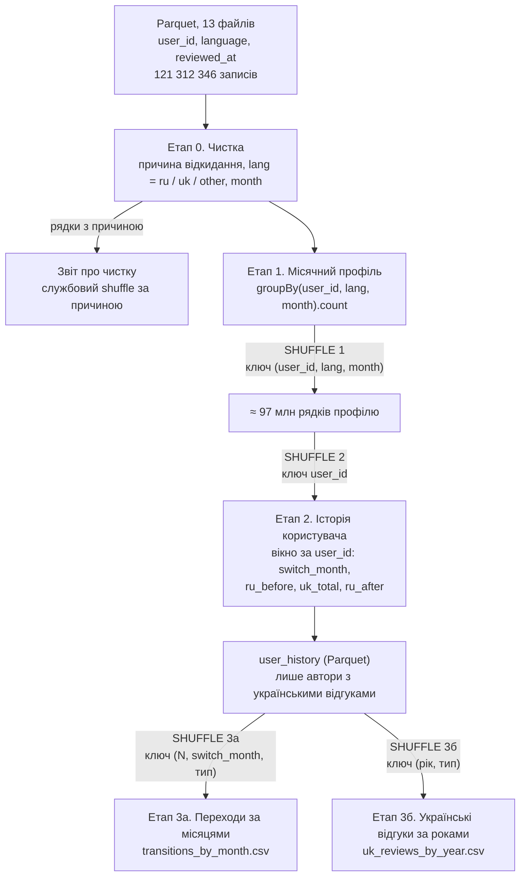

# Алгоритм: етапи, ключі й оцінка вартості

Питання до даних: скільки рецензентів Steam перейшли з російської мови відгуків на українську, коли це сталося і чи надовго. Визначення переходу й типів автора наведено в [PROPOSAL.md](PROPOSAL.md).

Оцінки в цьому документі зроблено до запуску на повному датасеті. Стовпці «Факт» і «Stage / вершина / job» заповнюються після запуску.

## 1. Вхідні дані

| Параметр | Значення |
|---|---|
| Записів (відгуків) | 121 312 346 |
| Колонки | `user_id` (int64), `language` (string), `reviewed_at` (timestamp) |
| Файлів | 13: 12 по 10 000 000 рядків і 1 на 1 312 346 рядків |
| Розмір на диску, МіБ | 1 821,831 (12 файлів по ≈ 150,1 і 1 файл 20,060) |
| Розмір без стиснення, МіБ | 2 369,916 |
| Відгуків `russian` | 13 584 758 |
| Відгуків `ukrainian` | 662 237 |
| Діапазон дат | 2010-10 … 2026-10, тобто 193 місяці |

## 2. Припущення для оцінки

| № | Припущення | Значення |
|---|---|---|
| П1 | Частка відгуків, що об'єднуються з іншими відгуками в спільний рядок (автор, група мови, місяць) | 20 % |
| П2 | Розміщення відгуків одного автора у вхідних задачах | рівномірне, без упорядкування за автором |
| П3 | Середня кількість українських відгуків на автора, який має хоча б один такий відгук | 2,5 |
| П4 | Середня кількість рядків історії (група мови, місяць) на автора з українськими відгуками | 3 |

- **П1** визначає, скільки рядків лишиться після етапу 1, а отже, обсяг shuffle 2.
- **П2** визначає ефективність комбайнера етапу 1: часткова агрегація об'єднує лише ті відгуки одного ключа, що потрапили в одну вхідну задачу.
- **П3** дає кількість авторів з українськими відгуками, тобто кількість авторів на виході етапу 2.
- **П4** дає кількість рядків, які етап 2 зберігає для кожного з цих авторів.

Розмір рядка shuffle. Рядок `(user_id, lang, month, count)` у форматі Spark UnsafeRow займає 8 байтів бітової маски null, 4 поля × 8 байтів і 8 байтів на рядок `lang`, тобто 48 байтів, плюс 4 байти довжини запису: разом 52 байти. Shuffle стискається lz4; для повторюваних ідентифікаторів і коротких рядків закладаю стиснення втричі: 52 / 3 ≈ 17,333 байта на запис.

Кількість задач. `spark.sql.files.maxPartitionBytes` = 128 МіБ, тому кожен файл на ≈ 150 МіБ ділиться на частину 128 МіБ і частину ≈ 22 МіБ. Великі частини йдуть по одній на задачу (12 задач). Малі Spark пакує разом до 128 МіБ, рахуючи 4 МіБ накладних витрат на кожну (`openCostInBytes`): по 5 в задачу, тобто 13 малих частин дають 3 задачі. Разом 15 вхідних задач. Shuffle має `spark.sql.shuffle.partitions` = 200. AQE зливає розділи лише менші за 1 МіБ (`parallelismFirst` = true), а розділи етапів 1 і 2 матимуть по ≈ 8–10 МіБ, тому очікую 200 задач на боці читання.

## 3. Схема етапів

Етап 2 споживає агрегований результат етапу 1: тип автора залежить від усієї його історії, а не від окремого відгуку. Етап 3 споживає результат етапу 2.

## 4. Етапи

### Етап 0. Чистка (без shuffle)

Кожен рядок отримує причину відкидання: `no_user`, `no_language`, `no_date`, `date_out_of_range` (поза 2010-01-01 … 2026-10-31) або null. Мова нормалізується (`trim`, `lower`) і зводиться до трьох груп: `ru`, `uk`, `other`. Дата обрізається до першого дня місяця. Етап виконується в тих самих задачах, що й читання, без обміну даними.

Окремий службовий job рахує кількість рядків за причиною для звіту. Ключів щонайбільше 5, тому його shuffle мізерний: ≤ 15 задач × 5 ключів = 75 записів.

### Етап 1. Місячний профіль

Ключ `(user_id, lang, month)`: відповідь потрібна з точністю до місяця, тому кілька відгуків автора однією мовою в одному місяці можна злити в один рядок із кількістю. Це зменшує вхід етапу 2 і обмежує кількість рядків одного автора: не більше 193 місяців × 3 групи = 579, хоч би скільки відгуків він написав. Так етап 1 заздалегідь зменшує перекіс етапу 2.

Комбайнер можливий: підрахунок асоціативний, і Spark сам виконує часткову агрегацію (`partial_count`) до shuffle. Але за П2 два відгуки одного ключа потрапляють в одну вхідну задачу з імовірністю ≈ 1/15, тому комбайнер прибере лише ≈ 0,2 × 1/15 ≈ 1,3 % рядків.

Розрахунок:
- shuffle write: 121 312 346 × (1 − 0,2 / 15) ≈ 119 694 848 записів; × 17,333 байта ≈ 1 978,598 МіБ;
- вихід: 121 312 346 × (1 − 0,2) ≈ 97 049 877 рядків (П1).

### Етап 2. Історія користувача

Ключ `user_id`: тип автора — властивість усієї його історії, тому всі рядки автора мають зустрітися в одній задачі. У коді це вікно `Window.partitionBy("user_id")`: місяць першого українського відгуку і три суми (`ru_before`, `uk_total`, `ru_after`). Автори без українських відгуків відкидаються одразу після обчислення `switch_month`.

Комбайнер неможливий: суми `ru_before` і `ru_after` залежать від `switch_month`, який відомий лише після того, як зібрано всі рядки автора. Тому в shuffle іде весь вихід етапу 1.

Розрахунок:
- shuffle write: 97 049 877 записів × 17,333 байта ≈ 1 604,269 МіБ;
- автори з українськими відгуками: 662 237 / 2,5 ≈ 264 895 (П3);
- вихід: 264 895 × 3 ≈ 794 685 рядків (П4); у Parquet по ≈ 12 байтів на рядок ≈ 9,094 МіБ.

Результат зберігається на диск (`user_history`), і обидва підсумки етапу 3 читають його звідти, а не перераховують етапи 1–2.

### Етап 3. Підсумки

**3а. Переходи за місяцями.** Для кожного автора лишається один рядок (місяць першого українського відгуку), він множиться на три пороги N = 1, 2, 3 і отримує тип автора. Ключ `(N, switch_month, тип автора)` відповідає на питання «скільки і коли» окремо для кожного порога.

**3б. Українські відгуки за роками.** Ключ `(рік, тип автора)` при N = 2: показує, хто дав зростання українських відгуків.

Комбайнер ефективний в обох випадках: ключів мало (щонайбільше 3 × 193 × 4 = 2 316 і 17 × 4 = 68), тож кожна вхідна задача відправляє в shuffle не більше одного рядка на ключ.

Розрахунок. Етап 2 запише 200 малих файлів `user_history` (по одному на задачу); Spark пакує їх з урахуванням 4 МіБ накладних витрат на файл, тож очікую ≈ 8 вхідних задач:
- 3а: вхід 264 895 × 3 = 794 685 рядків; реально трапиться ≈ 1 500 ключів; shuffle ≈ 8 × 1 500 = 12 000 записів × 52 байти ≈ 0,595 МіБ;
- 3б: вхід — українські рядки історії, не більше 662 237; shuffle ≈ 8 × 68 = 544 записи × 52 байти ≈ 0,027 МіБ.

### Перевірка поля мови (окрема програма)

`check_language.py` читає 2 файли з текстом (20 000 000 рядків, 2 910,449 МіБ на диску) і рахує кількість відгуків за ключем `(група поля мови, мова тексту)`: 3 × 6 (вивід check_language.py) = 18 ключів. Комбайнер ефективний: 23 вхідні задачі × 18 ключів ≤ 414 записів у shuffle.

## 5. Таблиця етапів

| Етап | Вхід (ключ, значення) | Вихід (ключ, значення) | Що йде в shuffle | Оцінка записів і байтів | Факт | Stage / вершина / job |
|---|---|---|---|---|---|---|
| 0. Чистка | (—, відгук `user_id, language, reviewed_at`) | ((`user_id`, `lang`, `month`), 1) | нічого | читання: 121 312 346 записів, 1 821,831 МіБ на диску; 15 задач | | |
| Службовий: звіт про чистку | (причина, 1) | (причина, кількість рядків) | часткові суми за причиною | ≤ 75 записів, < 0,001 МіБ | | |
| 1. Місячний профіль | ((`user_id`, `lang`, `month`), 1) | ((`user_id`, `lang`, `month`), `reviews`) | часткові суми після комбайнера, розподіл за хешем `(user_id, lang, month)` | shuffle: ≈ 119 694 848 записів, ≈ 1 978,598 МіБ; вихід ≈ 97 049 877 рядків; 200 задач | | |
| 2. Історія користувача | (`user_id`, (`lang`, `month`, `reviews`)) | (`user_id`, (`lang`, `month`, `reviews`, `switch_month`, `ru_before`, `uk_total`, `ru_after`)) | усі рядки профілю, розподіл за хешем `user_id` | shuffle: ≈ 97 049 877 записів, ≈ 1 604,269 МіБ; вихід ≈ 794 685 рядків, ≈ 9,094 МіБ; 200 задач | | |
| 3а. Переходи за місяцями | ((N, `switch_month`, тип), 1) | ((N, `switch_month`, тип), `users`) | часткові суми, ≤ 1 рядок на ключ на задачу | вхід ≈ 794 685 рядків; shuffle ≈ 12 000 записів, ≈ 0,595 МіБ | | |
| 3б. Українські відгуки за роками | ((рік, тип), `reviews`) | ((рік, тип), `uk_reviews`) | часткові суми, ≤ 1 рядок на ключ на задачу | вхід ≤ 662 237 рядків; shuffle ≈ 544 записи, ≈ 0,027 МіБ | | |
| Перевірка мови | (—, `language, review`) | ((група поля, мова тексту), кількість) | часткові суми, ≤ 18 рядків на задачу | читання: 20 000 000 записів, 2 910,449 МіБ; 23 задачі; shuffle ≤ 414 записів | | |
