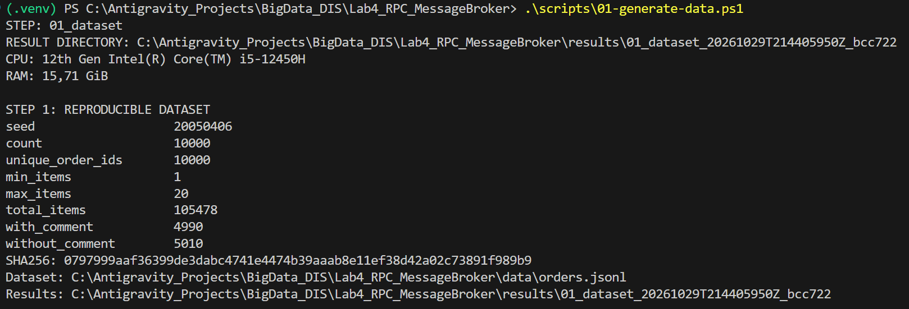
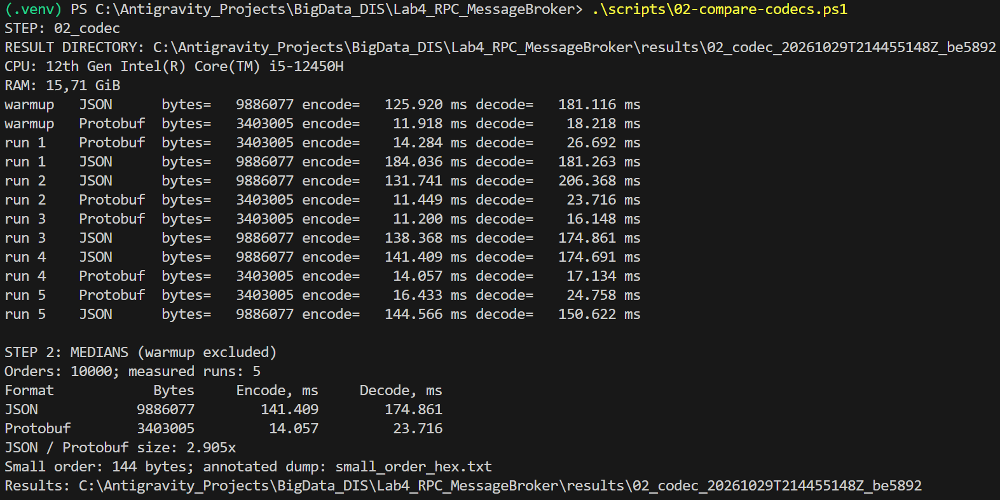
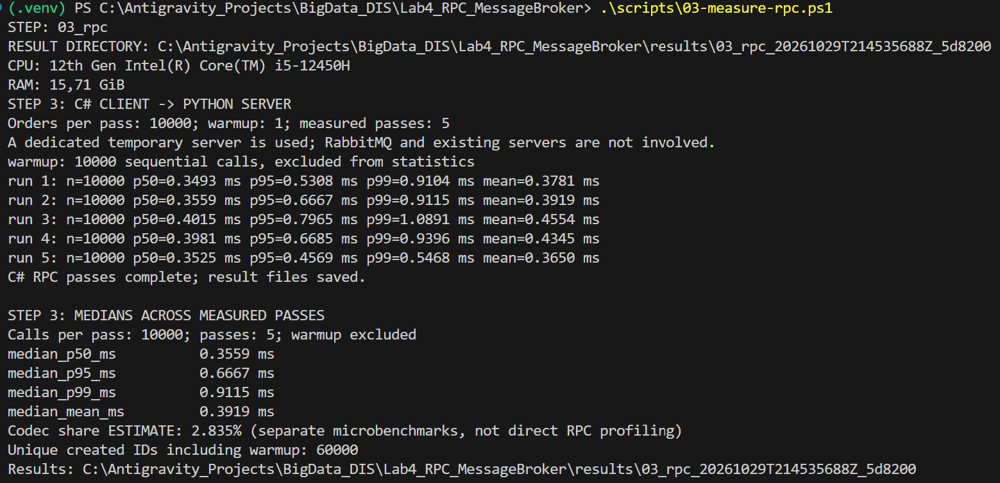
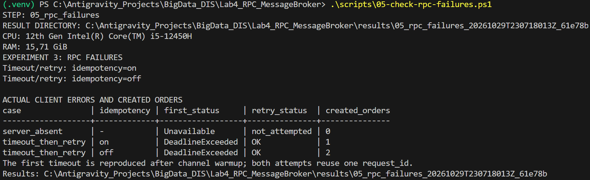
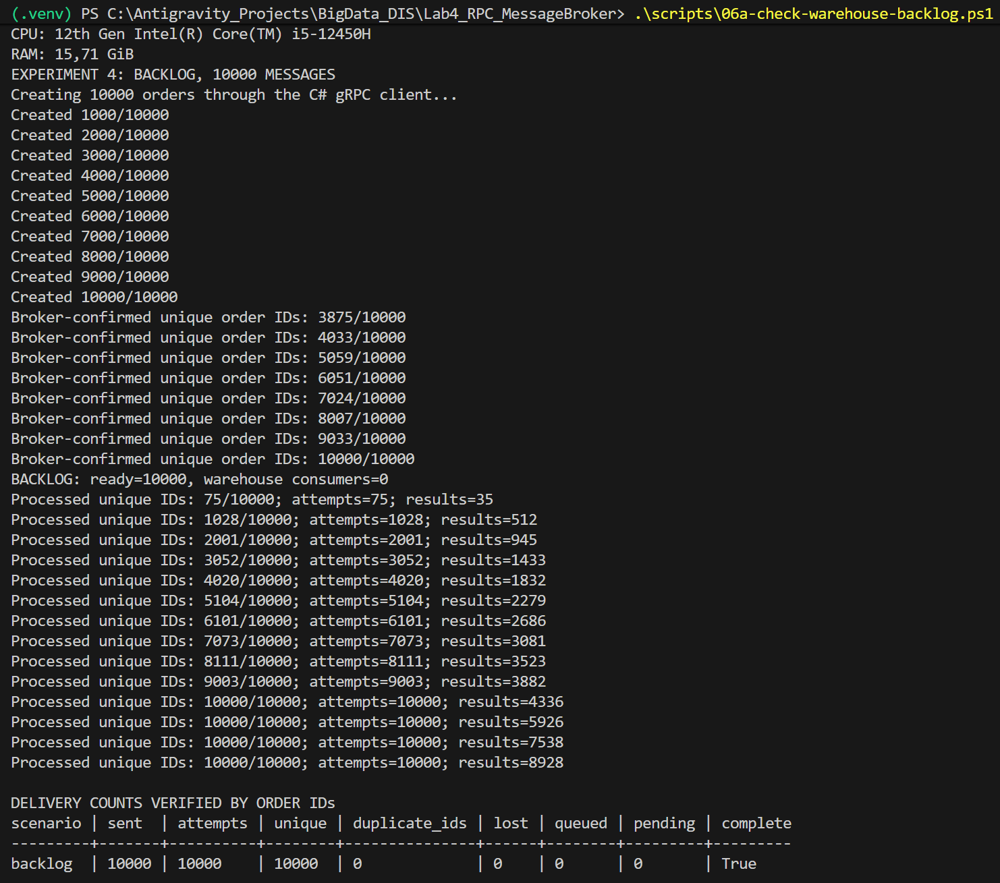
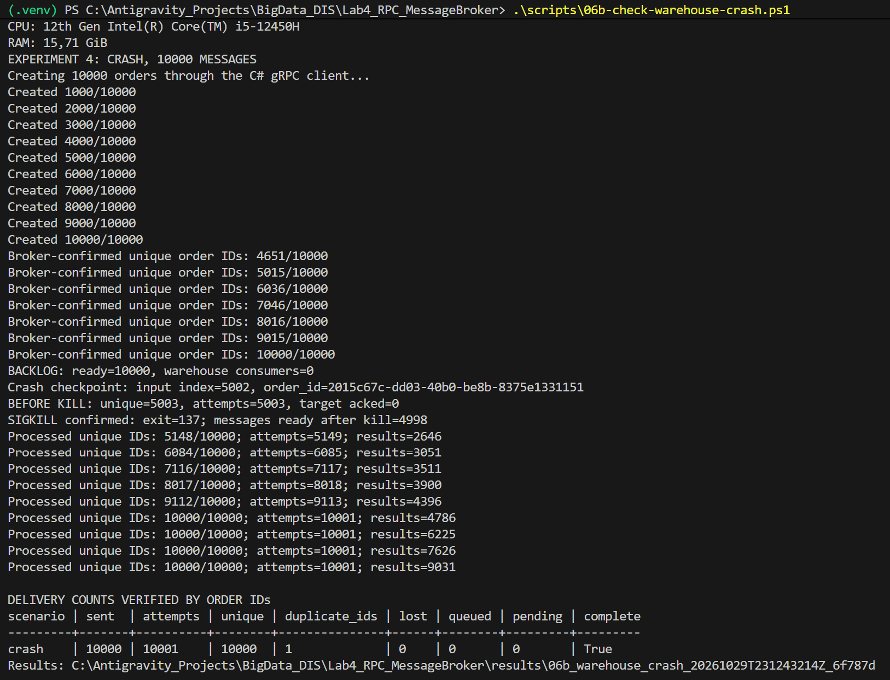

# Розподілені інформаційні системи. Практичне завдання 4: кодування даних, RPC і черга повідомлень

*Виконав: Вяльцев Олександр*

Реалізовано систему обробки замовлень із трьох процесів: клієнт на C#, сервіс
замовлень на Python і сервіс складу на Python. Клієнт звертається до сервісу
замовлень через gRPC. Сервіс замовлень і склад обмінюються повідомленнями через
RabbitMQ, запущений локально в Docker. Для обох способів передавання використано
Protocol Buffers.

Сервіс замовлень підтримує створення замовлення, отримання за ідентифікатором
і список замовлень покупця. Нове замовлення отримує стан `PENDING`. Склад резервує
товари й публікує результат, після чого стан змінюється на `CONFIRMED` або
`REJECTED`. Замовлення та залишки товарів зберігаються в пам’яті процесів.

## Код і запуск системи

Схеми збережені окремо: [v1](schemas/v1/orders.proto), [v2](schemas/v2/orders.proto)
і [варіант із несумісною зміною](schemas/v2_breaking/orders.proto).
Код клієнта знаходиться в [client](client/), сервісу замовлень — у [server](server/),
складу — у [warehouse](warehouse/). Налаштування брокера й контейнера складу
містяться в [docker-compose.yml](docker-compose.yml).

Команди виконуються в PowerShell із папки `Lab4_RPC_MessageBroker`.
Підготовка Python-середовища, генерація коду зі схем і збирання C#-клієнтів:

```powershell
.\scripts\setup.ps1
```

Для запуску системи потрібно вибрати `v1` або `v2`:

```powershell
$schema = 'v1' # Для другої версії: 'v2'
$env:DIS_SCHEMA = $schema
$env:DIS_NAMESPACE = $schema
docker compose --profile workers up -d --build
.\scripts\start-server.ps1 -Schema $schema -Namespace $schema -WithBroker
```

В іншому терміналі клієнт запускається з тією самою версією схеми:

```powershell
$env:DIS_SCHEMA = 'v1' # Або 'v2'
.\scripts\start-client.ps1
```

Перед переходом на іншу версію сервіс замовлень зупиняється через `Ctrl+C`.

## Дані та середовище

Усі процеси та брокер працювали на одному комп’ютері: Intel Core i5-12450H,
8 ядер, 12 логічних процесорів, 15,71 ГіБ RAM, Windows 11.
Клієнт зібрано для .NET 10: SDK 10.0.403, runtime 10.0.14.
Використано `Grpc.Net.Client` 2.84.0, `Grpc.Tools` 2.85.0 і `Google.Protobuf` 3.36.2.
На хості встановлено Python 3.12.6, `grpcio` і `grpcio-tools` 1.85.0,
`protobuf` 7.36.2 та `pika` 1.4.4. Брокер використовує образ `rabbitmq:4.2-management`.

[Генератор](experiments/generate.py) створив 10 000 різних замовлень із фіксованим
seed `20050406`. У кожному замовленні від 1 до 20 позицій, загалом — 105 478
позицій. Коментар присутній у 4990 замовленнях, відсутній у 5010.
Ціни зберігаються цілими числами в копійках.

```powershell
.\scripts\01-generate-data.ps1
```



*Рисунок 1. Параметри набору: seed, кількість унікальних замовлень, позицій і коментарів.*

Окремий невеликий запис збережено у файлах [order.json](examples/order.json)
і [order.pb](examples/order.pb). Його бінарний розмір — 144 байти.
[order_hex.txt](examples/order_hex.txt) містить шістнадцятковий дамп із позначенням
номерів полів, типів кодування, довжин і значень.

## Експеримент 1 — розмір і швидкість кодування

Ті самі 10 000 замовлень закодовано в компактний JSON UTF-8 і Protocol Buffers.
Окремо виміряно кодування та декодування. Читання файлів, перетворення початкових
словників на Protobuf-об’єкти й перевірка результатів виконувалися поза замірами.
Розмір JSON пораховано без розділювачів рядків JSONL.

Перед вимірюваннями виконано один прогрівальний запуск, після нього — п’ять
вимірюваних. Підсумкові значення — медіани без прогріву.

```powershell
.\scripts\02-compare-codecs.ps1
```



*Рисунок 2. Прогрів, п’ять повторів і медіани розміру, часу кодування та декодування.*

JSON зайняв 9 886 077 байтів, Protobuf — 3 403 005 байтів.
На цьому наборі Protobuf компактніший у **2,905 раза**. Медіана кодування становила
141,409 мс для JSON і 14,057 мс для Protobuf; декодування — 174,861 мс і 23,716 мс
відповідно.

### Час відповіді на створення замовлення

Використано C#-клієнт і окремий Python-сервер без підключення до брокера.
Клієнт повторно використовував один gRPC-канал і виконував виклики послідовно.
Прогрів містив 10 000 викликів, кожен із п’яти вимірюваних запусків — ще по
10 000. Загалом створено 60 000 замовлень з унікальними ID.

```powershell
.\scripts\03-measure-rpc.ps1
```



*Рисунок 3. Перцентилі кожного запуску й медіани показників за п’ятьма запусками.*

Медіани показників становили: **p50 — 0,3559 мс**, **p95 — 0,6667 мс**,
**p99 — 0,9115 мс**. Медіана середнього часу відповіді — 0,3919 мс.
За окремими вимірюваннями кодування та декодування на клієнті й сервері їхній
сумарний внесок оцінено у **2,835%** середнього часу відповіді.

## Експеримент 2 — еволюція схеми

### Додавання й видалення поля

У v2 додано необов’язкове поле `promo_code`, а `comment` видалено. У повідомленні
`Order` промокод має номер 8, старий номер 7 і назву `comment` зарезервовано.
У `CreateOrderRequest` промокод має номер 6, зарезервовано номер 5 і назву `comment`.

```powershell
.\scripts\04a-check-rpc-schema.ps1
.\scripts\04b-check-broker-schema.ps1
```

Матриця прочитування полів для клієнта → сервера та сервісу замовлень → складу:

| Хто пише | Хто читає | Коментар у читача | Промокод у читача |
|---|---|---|---|
| v1 | v1 | `NOTE_V1` | Немає у схемі |
| v1 | v2 | Ігнорується як невідоме поле | Відсутній, значення `""` |
| v2 | v1 | Відсутній, значення `""` | Ігнорується як невідоме поле |
| v2 | v2 | Немає у схемі | `PROMO_V2` |

Для відсутнього відомого необов’язкового поля ознака присутності дорівнює `false`.
Усі RPC-виклики завершилися зі статусом `OK`. Якщо поле було відсутнє вже у
відправника, відомий читачеві коментар або промокод залишався відсутнім і повертав
порожній рядок.

Усі вісім комбінацій версій клієнта, сервісу замовлень і складу завершилися станом
`CONFIRMED`. Окремо при зупиненому складі накопичено три повідомлення v1.
Після запуску складу v2 оброблено всі три ID, втрат — 0. Старий коментар був
невідомим полем, новий промокод — відсутнім.

Початкові таблиці: [RPC](results/04a_rpc_schema_20261029T223614768Z_24ce06/screenshot.png)
і [обмін через брокер](results/04b_broker_schema_20261029T223748677Z_c4d891/screenshot.png).

### Повторне кодування старим процесом

Перевірено шлях `v2 → v1 → v2`: старий процес декодує повідомлення з промокодом
і кодує його знову. Перевірки виконано для Python і C#; результати в обох мовах
однакові.

```powershell
.\scripts\04c-check-unknown-fields.ps1
```

| Спосіб повторного кодування у v1 | Промокод після читання у v2 | Поле збережено |
|---|---|---|
| Той самий Protobuf-об’єкт | `PROMO_V2` | Так |
| Перетворення через JSON | Відсутній, значення `""` | Ні |
| Новий об’єкт із відомих полів | Відсутній, значення `""` | Ні |

Початковий вивід: [перевірка невідомого поля](results/04c_unknown_fields_20261029T223909296Z_7869a4/screenshot.png).

### Несумісна зміна

У варіанті `v2_breaking` відносно v1 змінено лише тип ціни:
`int64 unit_price_minor = 3` на `sint64 unit_price_minor = 3`.
Перевірку виконано окремо від додавання промокоду та видалення коментаря.

```powershell
.\scripts\04d-check-breaking-schema.ps1
```

Ціна після декодування збігалася в RPC-сервері та на складі. Результати для двох
тестових цін, у копійках:

| Хто пише | Хто читає | Надіслано | Декодовано | Ціна у відповіді RPC | Статус RPC | Стан через чергу |
|---|---|---:|---:|---:|---|---|
| v1 | v1 | 16000 | 16000 | 16000 | `OK` | `CONFIRMED` |
| v1 | v1 | 15999 | 15999 | 15999 | `OK` | `CONFIRMED` |
| v1 | v2_breaking | 16000 | 8000 | 16000 | `OK` | `CONFIRMED` |
| v1 | v2_breaking | 15999 | −8000 | — | `INVALID_ARGUMENT` | `CONFIRMED` |
| v2_breaking | v1 | 16000 | 32000 | 16000 | `OK` | `CONFIRMED` |
| v2_breaking | v1 | 15999 | 31998 | 15999 | `OK` | `CONFIRMED` |
| v2_breaking | v2_breaking | 16000 | 16000 | 16000 | `OK` | `CONFIRMED` |
| v2_breaking | v2_breaking | 15999 | 15999 | 15999 | `OK` | `CONFIRMED` |

Додатні спотворені ціни були збережені сервером. Від’ємну ціну відхилила перевірка
даних зі статусом `INVALID_ARGUMENT`. У випадку 16000 → 8000 відповідь RPC знову
містила 16000, хоча на сервері було збережено 8000.

Склад підтвердив замовлення навіть зі спотвореною ціною: резервування використовує
ідентифікатор товару й кількість. Початкові таблиці з декодованими, збереженими
та повернутими значеннями: [несумісна зміна](results/04d_breaking_schema_20261029T223936457Z_360ba4/screenshot.png).

## Експеримент 3 — збої під час виклику

Перевірено недоступний сервер і повторний виклик після таймауту. Для другого
сценарію сервер затримував відповідь на 2000 мс після створення замовлення.
Перший таймаут клієнта — 0,5 с, таймаут повторної спроби — 10 с.
Обидві спроби передавали той самий `request_id`.

```powershell
.\scripts\05-check-rpc-failures.ps1
```



*Рисунок 4. Статуси клієнта та фактична кількість створених замовлень.*

При вимкненому сервері клієнт отримав `Unavailable`, створено 0 замовлень.
При повільній відповіді перша спроба завершилася `DeadlineExceeded`, повторна —
`OK`. З увімкненою ідемпотентністю створено одне замовлення, з вимкненою — два.
Кількість перевірено за ID у сервісі замовлень.

## Експеримент 4 — збої під час обміну через чергу

Для обох сценаріїв сервіс замовлень опублікував 10 000 повідомлень із підтвердженням
брокера. Використано стійкі черги та повідомлення зі збереженням на диск.
Склад отримував по одному непідтвердженому повідомленню (`prefetch_count=1`)
і надсилав `ack` після обробки та підтвердженої публікації результату.

### Склад зупинений під час публікації

Спочатку зафіксовано 10 000 повідомлень у черзі та 0 споживачів складу.
Після цього склад запущено для обробки накопичених замовлень.

```powershell
.\scripts\06a-check-warehouse-backlog.ps1
```



*Рисунок 5. Накопичення 10 000 повідомлень і підсумкові лічильники після запуску складу.*

Оброблено 10 000 унікальних замовлень за 10 000 спроб. Втрачених і повторно
оброблених повідомлень — 0. У черзі та у стані очікування залишилося 0 замовлень.

### Примусове завершення складу

Склад примусово завершено командою `docker kill --signal KILL` після обробки
5003 унікальних замовлень. Для вибраного замовлення результат уже було
опубліковано, а підтвердження вхідного повідомлення ще не надіслано.
Контейнер завершився з кодом 137. Після завершення складу в черзі було
4998 готових до отримання повідомлень.

```powershell
.\scripts\06b-check-warehouse-crash.ps1
```



*Рисунок 6. Момент SIGKILL, продовження обробки після перезапуску та звірка ID.*

Після перезапуску отримано 10 001 спробу обробки для 10 000 унікальних замовлень.
Одне замовлення оброблено двічі: `2015c67c-dd03-40b0-be8b-8375e1331151`.
Втрачених повідомлень — 0, у черзі та у стані очікування залишилося 0 замовлень.
Лічильники обчислено зі списків відправлених та оброблених ID.

## Відповіді на питання до звіту

1. Який формат кодування, транспорт, брокер і мови ви обрали і чому? Якщо транспорт — власний протокол поверх TCP або UDP: як отримувач визначає, де закінчується одне повідомлення і починається наступне? Якщо gRPC або Thrift RPC: що саме фреймворк зробив за вас? З якими відмінностями між двома мовами ви зіткнулися в згенерованому коді (типи, необов'язкові поля, значення за замовчуванням)?

Для кодування обрано Protocol Buffers, для синхронних викликів — gRPC, для
асинхронного обміну — RabbitMQ у Docker. Клієнт написано на C#, сервіс замовлень
і склад — на Python. Protocol Buffers дає спільну схему та генерацію коду для
обох мов. Той самий формат використано в чергах, щоб не підтримувати окрему
схему й інший спосіб кодування для тих самих замовлень. gRPC забезпечує виклик
типізованих методів між різними мовами, а RabbitMQ дозволяє накопичувати
замовлення, поки склад не працює. C# використано для типізованого клієнта,
Python — для реалізації сервісів і скриптів експериментів.

gRPC згенерував клієнтські методи й серверні обробники зі спільного `.proto`,
забезпечив передавання через HTTP/2, визначення меж повідомлень, кодування
та декодування, статуси помилок і контроль таймаутів. Власний протокол
розділення повідомлень реалізовувати не довелося.

У згенерованому коді відрізняються назви властивостей, представлення чисел,
колекцій і перевірка присутності необов’язкових полів:

| Елемент схеми | C# | Python |
|---|---|---|
| `int64 unit_price_minor` | `long UnitPriceMinor` | `int`, поле `unit_price_minor` з обмеженням діапазону `int64` |
| `uint32 quantity` | `uint Quantity` | `int`, поле `quantity` з обмеженням діапазону `uint32` |
| `repeated OrderItem items` | `RepeatedField<OrderItem> Items` | Контейнер повторюваних повідомлень `items` |
| `optional string comment` | `Comment`, перевірка `HasComment` | `comment`, перевірка `HasField("comment")` |

В обох мовах відсутній необов’язковий рядок повертає `""`, але ознака його
присутності дорівнює `false`. Тому відсутній коментар можна відрізнити від
явно заданого порожнього. Значення за замовчуванням для чисел — `0`,
для стану — `ORDER_STATUS_UNSPECIFIED`, для списку позицій — порожня колекція.

2. У скільки разів бінарне кодування компактніше за JSON на ваших даних? Який вигляд має шістнадцятковий дамп одного невеликого замовлення і які байти є номером поля, типом, довжиною, значенням? Звідки береться економія?

Для тих самих 10 000 замовлень JSON займає 9 886 077 байтів, а Protocol Buffers —
3 403 005 байтів. Відношення `9 886 077 / 3 403 005 = 2,905`, тобто бінарне
кодування компактніше приблизно у 2,905 раза.

Шістнадцятковий дамп замовлення `3cdd855f-de76-487c-9f08-45c83b9b7355`
з однією позицією та без коментаря має розмір 144 байти. Ліворуч указано
зміщення у шістнадцятковій системі:

```text
0000: 0A 24 33 63 64 64 38 35 35 66 2D 64 65 37 36 2D
0010: 34 38 37 63 2D 39 66 30 38 2D 34 35 63 38 33 62
0020: 39 62 37 33 35 35 12 0A 62 75 79 65 72 2D 30 32
0030: 34 38 1A 06 08 B3 F6 D6 CA 06 20 01 2A 41 0A 02
0040: 55 41 12 08 D0 9A D0 B8 D1 97 D0 B2 1A 2A D0 B2
0050: D1 83 D0 BB 2E 20 D0 A3 D0 BD D1 96 D0 B2 D0 B5
0060: D1 80 D1 81 D0 B8 D1 82 D0 B5 D1 82 D1 81 D1 8C
0070: D0 BA D0 B0 2C 20 31 33 22 05 31 37 37 33 33 32
0080: 0F 0A 08 73 6B 75 2D 30 39 31 31 10 09 18 F4 47
```

Номер поля і тип кодування поєднано в тегу за формулою
`тег = (номер поля << 3) | тип кодування`. Тип `0` означає ціле число у форматі
varint, тип `2` — значення з префіксом довжини: рядок або вкладене повідомлення.
Наприклад, `0A` означає поле № 1 із типом `2`, наступний байт `24` задає
довжину 36 байтів, а далі записано ідентифікатор замовлення в UTF-8.

| Зміщення | Поле | Тег | Номер / тип кодування | Байти довжини | Значення |
|---|---|---|---|---|---|
| `0000` | `order_id` | `0A` | 1 / 2 | `24` = 36 байтів | `3cdd855f-de76-487c-9f08-45c83b9b7355` |
| `0026` | `buyer_id` | `12` | 2 / 2 | `0A` = 10 байтів | `buyer-0248` |
| `0032` | `created_at` | `1A` | 3 / 2 | `06` = 6 байтів | Вкладене повідомлення часу |
| `0034` | `created_at.seconds` | `08` | 1 / 0 | — | `B3 F6 D6 CA 06` = 1767226163 |
| `003A` | `status` | `20` | 4 / 0 | — | `01` = `PENDING` |
| `003C` | `shipping_address` | `2A` | 5 / 2 | `41` = 65 байтів | Вкладене повідомлення адреси |
| `003E` | `shipping_address.country` | `0A` | 1 / 2 | `02` = 2 байти | `55 41` = `UA` |
| `0042` | `shipping_address.city` | `12` | 2 / 2 | `08` = 8 байтів | `Київ` у UTF-8 |
| `004C` | `shipping_address.street` | `1A` | 3 / 2 | `2A` = 42 байти | `вул. Університетська, 13` у UTF-8 |
| `0078` | `shipping_address.postal_code` | `22` | 4 / 2 | `05` = 5 байтів | `31 37 37 33 33` = `17733` |
| `007F` | `items` | `32` | 6 / 2 | `0F` = 15 байтів | Вкладене повідомлення однієї позиції |
| `0081` | `items.product_id` | `0A` | 1 / 2 | `08` = 8 байтів | `73 6B 75 2D 30 39 31 31` = `sku-0911` |
| `008B` | `items.quantity` | `10` | 2 / 0 | — | `09` = 9 |
| `008D` | `items.unit_price_minor` | `18` | 3 / 0 | — | `F4 47` = 9204 копійки |

У varint старший біт байта вказує на продовження числа, а решта сім бітів
містять його частину. Для `F4 47` значення дорівнює
`(0xF4 & 0x7F) + (0x47 << 7) = 9204`.

Економія виникає тому, що замість текстових назв полів передаються короткі теги,
числа записуються бінарно, а дужки, лапки, коми та двокрапки JSON не потрібні.
Необов’язковий коментар у цьому замовленні відсутній і байтів не займає.

3. Яку частку часу відповіді на виклик займають кодування й декодування? Чи впливає вибір формату на швидкодію саме вашої системи і за яких умов почав би впливати?

Сумарний час кодування та декодування запиту й відповіді оцінено у 11,108 мкс
на виклик. Медіана середнього часу відповіді gRPC становить 391,8595 мкс,
тому частка кодування й декодування дорівнює
`11,10787 / 391,8595 × 100% ≈ 2,835%`.

| Операція | Час на один виклик, мкс |
|---|---:|
| Кодування запиту на клієнті C# | 2,48812 |
| Декодування запиту на сервері Python | 1,66443 |
| Кодування відповіді на сервері Python | 1,02136 |
| Декодування відповіді на клієнті C# | 5,93396 |
| Разом | 11,10787 |

Це оцінка за окремими замірами на підготовлених повідомленнях, а не пряме
вимірювання всередині RPC. Для 10 000 послідовних викликів після прогріву
медіани показників за п’ятьма запусками становили: p50 — 0,3559 мс,
p95 — 0,6667 мс, p99 — 0,9115 мс. Брокер під час цих вимірювань був відключений.

У порівнянні форматів отримано такі медіани для всіх 10 000 замовлень:

| Формат | Кодування, мс | Декодування, мс |
|---|---:|---:|
| JSON | 141,409 | 174,861 |
| Protocol Buffers | 14,057 | 23,716 |

На цих даних Protobuf кодується й декодується швидше, але в локальному RPC
кодування займає невелику частку загального часу. Решта припадає на передавання,
роботу gRPC, планування виконання та обробку замовлення. Окреме порівняння RPC
з JSON не проводилося, тому приріст швидкості всього виклику від заміни формату
цими результатами не визначається. Вплив формату став би більшим для великих
повідомлень, високої кількості викликів або обмеженої пропускної здатності мережі.

4. Якою є матриця сумісності з експерименту 2? Що побачив отримувач на місці доданого і на місці видаленого поля в кожній комбінації? Чим закінчилася несумісна зміна — явною помилкою чи тихо зіпсованими даними, і що з цього небезпечніше?

У v2 додано необов’язкове поле `promo_code` і видалено `comment`. Номер і назву
видаленого поля зарезервовано, тому вони не використовуються для промокоду.
Для передавання від клієнта до сервера та від сервісу замовлень до складу
отримано однакову матрицю читання полів:

| Версія відправника | Версія отримувача | Видалене поле `comment` у отримувача | Додане поле `promo_code` у отримувача | Результат |
|---|---|---|---|---|
| v1 | v1 | `NOTE_V1` | Немає у схемі | Успішно |
| v1 | v2 | Невідоме поле, не використовується | Відсутнє, значення `""` | Успішно |
| v2 | v1 | Відсутнє, значення `""` | Невідоме поле, не використовується | Успішно |
| v2 | v2 | Немає у схемі | `PROMO_V2` | Успішно |

Для відсутнього відомого необов’язкового поля ознака присутності дорівнює
`false`. Якщо коментар або промокод не заданий і у відправника, він також
залишається відсутнім у отримувача. Усі чотири RPC-комбінації завершилися
зі статусом `OK`, а всі вісім комбінацій версій клієнта, сервісу замовлень
і складу — станом `CONFIRMED`. Отже, додавання й видалення поля не порушили
читання повідомлень, хоча старий код не використовував промокод, а новий — коментар.

Несумісну зміну перевірено окремо у схемі `v2_breaking`: тип поля
`unit_price_minor` з тим самим номером 3 змінено з `int64` на `sint64`.
Обидва типи використовують varint, але `sint64` додатково застосовує ZigZag,
тому ті самі байти інтерпретуються по-різному. У таблиці ціни наведено в копійках;
у RPC отримувачем є сервер, у черзі — склад.

| Відправник | Отримувач | Надіслана ціна | Декодована ціна | Результат RPC | Результат обробки через чергу |
|---|---|---:|---:|---|---|
| v1 | v1 | 16000 | 16000 | `OK` | `CONFIRMED` |
| v1 | v1 | 15999 | 15999 | `OK` | `CONFIRMED` |
| v1 | v2_breaking | 16000 | 8000 | `OK`, збережено 8000 | `CONFIRMED` |
| v1 | v2_breaking | 15999 | −8000 | `INVALID_ARGUMENT`, не збережено | `CONFIRMED` |
| v2_breaking | v1 | 16000 | 32000 | `OK`, збережено 32000 | `CONFIRMED` |
| v2_breaking | v1 | 15999 | 31998 | `OK`, збережено 31998 | `CONFIRMED` |
| v2_breaking | v2_breaking | 16000 | 16000 | `OK` | `CONFIRMED` |
| v2_breaking | v2_breaking | 15999 | 15999 | `OK` | `CONFIRMED` |

Protobuf не повідомив про помилку декодування. Від’ємну ціну відхилила лише
перевірка даних на RPC-сервері, а додатні спотворені значення було збережено.
При передаванні 16000 у напрямку v1 → v2_breaking сервер зберіг 8000,
але клієнт після зворотного декодування відповіді знову побачив 16000.
Склад підтвердив навіть замовлення зі спотвореною ціною, оскільки резервування
залежить від товару й кількості. Тихе спотворення небезпечніше за явну помилку:
виклик виглядає успішним, хоча система вже працює з неправильними даними.

5. Чи збереглося невідоме поле, коли старий код декодував і заново закодував нове повідомлення? Від чого це залежить у вашому форматі й вашій бібліотеці?

У перевірці `v2 → v1 → v2` промокод `PROMO_V2` зберігся, коли процес v1
декодував і повторно закодував той самий Protobuf-об’єкт. Однаковий результат
отримано у Python з `protobuf` 7.36.2 та у C# з `Google.Protobuf` 3.36.2.
Старий код не мав властивості промокоду, але бібліотеки зберегли його як
невідоме поле й включили у повторне бінарне кодування.

| Спосіб повторного кодування у v1 | Python | C# | Значення після читання у v2 |
|---|---|---|---|
| Той самий Protobuf-об’єкт | Поле збережено | Поле збережено | `PROMO_V2` |
| Перетворення через JSON | Поле втрачено | Поле втрачено | Відсутнє, `""` |
| Новий об’єкт лише з відомих полів | Поле втрачено | Поле втрачено | Відсутнє, `""` |

Отже, збереження залежить від підтримки невідомих полів бібліотекою та способу
перетворення повідомлення. У нашому RPC-сервісі `Order` створюється заново
з відомих полів `CreateOrderRequest`. Тому сервер v1 не переносить невідомий
промокод у створене замовлення, хоча пряме повторне кодування того самого
об’єкта його зберігає.

6. Чи може клієнт в експерименті 3 відрізнити «запит не дійшов» від «запит виконано, але відповідь не дійшла»? Скільки замовлень створилося після повторного виклику і що ви зробили (або зробили б), щоб повтор був безпечним?

За самим таймаутом клієнт не може визначити, чи запит не дійшов до сервера,
чи сервер уже створив замовлення, але відповідь не встигла надійти. У нашому
експерименті затримка 2000 мс була встановлена після збереження замовлення.
Клієнт чекав 0,5 с і отримував `DeadlineExceeded`, хоча замовлення вже існувало.
Повторний виклик із таймаутом 10 с завершувався успішно.

| Сценарій | Перша спроба | Повторна спроба | Фактично створено замовлень |
|---|---|---|---:|
| Сервер не запущений | `Unavailable` | Не виконувалася | 0 |
| Повільна відповідь, ідемпотентність увімкнена | `DeadlineExceeded` | `OK` | 1 |
| Повільна відповідь, ідемпотентність вимкнена | `DeadlineExceeded` | `OK` | 2 |

Для безпечного повтору клієнт передає той самий `request_id`. Сервер зберігає
відповідність між цим ID, вмістом запиту та створеним замовленням. Якщо запит
повторюється з тими самими даними, сервер повертає вже створене замовлення.
Якщо дані для того самого ID відрізняються, повертається `ALREADY_EXISTS`.
Кількість створених замовлень перевірено за їхніми ID. У цій реалізації записи
для ідемпотентності зберігаються в пам’яті, тому захист діє, поки сервер
не перезапущено.

7. Чи були в експерименті 4 втрачені або двічі оброблені повідомлення? Які налаштування брокера і коду (підтвердження, збереження на диск, момент підтвердження відносно обробки) це визначають? Яку гарантію доставки ви фактично отримали?

В обох сценаріях сервіс замовлень опублікував 10 000 повідомлень
із підтвердженням брокера. Кількість обробок, втрат і повторів визначено
зі звірки відправлених та оброблених ID.

| Сценарій | Надіслано | Спроб обробки | Унікальних оброблених замовлень | ID, оброблених двічі | Втрачено |
|---|---:|---:|---:|---:|---:|
| Склад зупинений під час публікації, потім запущений | 10 000 | 10 000 | 10 000 | 0 | 0 |
| Склад примусово завершений під час обробки, потім перезапущений | 10 000 | 10 001 | 10 000 | 1 | 0 |

У першому сценарії повідомлення накопичилися в черзі та були оброблені
після запуску складу. У другому склад завершено після обробки 5003 унікальних
замовлень, коли результат одного з них уже був опублікований, але `ack`
для вхідного повідомлення ще не надісланий. Після перезапуску брокер передав
його повторно. Двічі оброблено замовлення
`2015c67c-dd03-40b0-be8b-8375e1331151`.

Черги оголошено з `durable=True`, повідомлення публікуються з `delivery_mode=2`,
а дані RabbitMQ зберігаються у Docker-томі. Відправник використовує
`publisher confirms`. На складі встановлено `auto_ack=False` і
`prefetch_count=1`: підтвердження надсилається після обробки замовлення
та підтвердженої брокером публікації результату. Якщо процес завершується
до `ack`, повідомлення залишається непідтвердженим і надходить знову.
Підтвердження до обробки створило б ризик втрати роботи при збої.

Фактично для підтверджених брокером повідомлень у цих сценаріях отримано
доставку щонайменше один раз — `at-least-once`. Втрат не було, але повторна
обробка можлива. Склад пам’ятає оброблені ID лише в пам’яті, тому після
перезапуску цей захист від дублікатів втрачається. Гарантії `exactly-once`
ця реалізація не забезпечує.

8. У якому порядку, спираючись на свою матрицю сумісності, слід оновлювати процеси вашої системи під час переходу з v1 на v2 — окремо для частини A і для частини B? Яка сумісність (backward чи forward) потрібна в кожному випадку і чому для черги це складніше, ніж для виклику?

У нашій матриці додавання `promo_code` і видалення `comment` сумісні в обох
напрямках: v2 читає повідомлення v1, а v1 читає повідомлення v2, пропускаючи
невідомі поля. Backward compatibility означає, що новий читач розуміє старі
повідомлення, forward compatibility — що старий читач може прочитати нові.
Водночас успішне читання не означає, що стара версія використає новий промокод
або перенесе його у новостворене повідомлення.

Для частини A доцільно спочатку оновити сервіс замовлень, потім клієнтів.
Новий сервер приймає запити старих клієнтів, а старі клієнти читають його
відповіді. Промокод слід починати передавати після оновлення сервера,
оскільки сервер v1 не переносить його у створене замовлення. Використання
коментаря потрібно припинити до переходу на сервер v2, який цього поля
вже не обробляє.

| Частина системи та перехідний обмін | Потрібна сумісність |
|---|---|
| A: клієнт v1 → сервер v2, запит | Backward: новий сервер читає старий запит |
| A: сервер v2 → клієнт v1, відповідь | Forward: старий клієнт читає нову відповідь |
| B: сервіс замовлень v1 → склад v2, подія замовлення | Backward: новий склад читає старі події |
| B: склад v2 → сервіс замовлень v1, результат | Forward: старий сервіс читає новий результат |

Для частини B спочатку можна оновити склад як споживача подій замовлень,
потім сервіс замовлень як їхнього відправника. Зворотні повідомлення
`OrderProcessed` у v2 не змінювалися, тому сервіс замовлень v1 може читати
результати від складу v2. Після оновлення сервісів можна оновлювати клієнтів
і використовувати промокод. Матриця дозволяє й інший порядок на рівні
декодування, але старий процес не використовуватиме нові поля.

Для черги перехід складніший, оскільки старі повідомлення можуть залишатися
в брокері після оновлення всіх відправників і повторно надходити після збою.
Новий склад має вміти читати цей накопичений потік. Це підтверджено перевіркою:
три повідомлення v1, опубліковані при зупиненому складі, після запуску складу
v2 оброблено без втрат.

Для зміни `int64 → sint64` зі збереженням номера поля безпечного порядку
поступового оновлення немає: змішані версії спотворюють ціну. Потрібно
ввести поле з новим номером і спочатку навчити отримувачів його читати,
або узгоджено зупинити старі процеси та обробити чи перетворити старі
повідомлення в черзі перед переходом.
