# Spark — RDD, ліниві обчислення і паралелізм

Конвеєр із MapReduce перенесено на RDD API: спочатку суми за парою дата/категорія,
потім категорія-лідер за весь період. Завдання 2 використовує результат Завдання 1.
Суми обчислюються в цілих копійках. Обчислення запускає одна фінальна дія `collect()`;
на driver надходить один запис із лідером та кількістю денних підсумків.

Виміри виконано 28.10.2026. У кожному сценарії є один прогрів і три вимірювані
повтори. Медіани розраховано без прогріву. Часові позначки Spark у журналах — UTC.

## Дані та середовище

| Параметр | Значення |
|---|---|
| Spark | 4.2.0 |
| Образ | `apache/spark:4.2.0-scala2.13-java21-python3-ubuntu` |
| Базовий режим | `local[4]` |
| Heap driver | 2 ГіБ |
| Логічні процесори Windows / CPU Docker | 12 / 12 |
| CSV на хості | `../Lab3_MapReduce/transactions.csv` |
| CSV у контейнері | `/data/transactions.csv` |
| Розмір CSV | 331348600 байтів |
| Транзакції без заголовка | 8000000 |
| Користувачі | 9000 |
| Категорії | 10 |
| Дати | 360, від 01.01.2026 до 26.12.2026 |
| Seed | 20050406 |

Використано CSV з попередньої лабораторної. Його генератор знаходиться в
[Lab3_MapReduce/generate_transactions.py](../Lab3_MapReduce/generate_transactions.py).
Команда генерації з папки `Lab3_MapReduce`:

```powershell
python generate_transactions.py 8000 transactions.csv --seed 20050406 --days 360 --max-mb 400
```

Перші три транзакції перевірено відтворенням із цими параметрами.
Статистика всього CSV, команда генерації та SHA-256 збережені в
[dataset.json](evidence/dataset.json).

## Частина 1 — один ланцюжок RDD

Файл поділено на 10 початкових розділів. Результат Завдання 1 містить 3600 записів:
360 дат × 10 категорій. Категорія-лідер — **travel**, сума — **328460729,51**.

У кожному повторі ланцюжок побудовано заново від `sc.textFile`, без кешування.
Одна дія створює один job із чотирма stages і 31 задачею: 10 + 10 + 10 + 1.
Три shuffle відповідають трьом викликам `reduceByKey` у конвеєрі.

| Прогрів, с | Повтор 1, с | Повтор 2, с | Повтор 3, с | Медіана, с |
|---:|---:|---:|---:|---:|
| 14,571566 | 12,076513 | 11,857526 | 11,734204 | **11,857526** |

Початковий вивід: [part1.log](evidence/logs/part1.log).

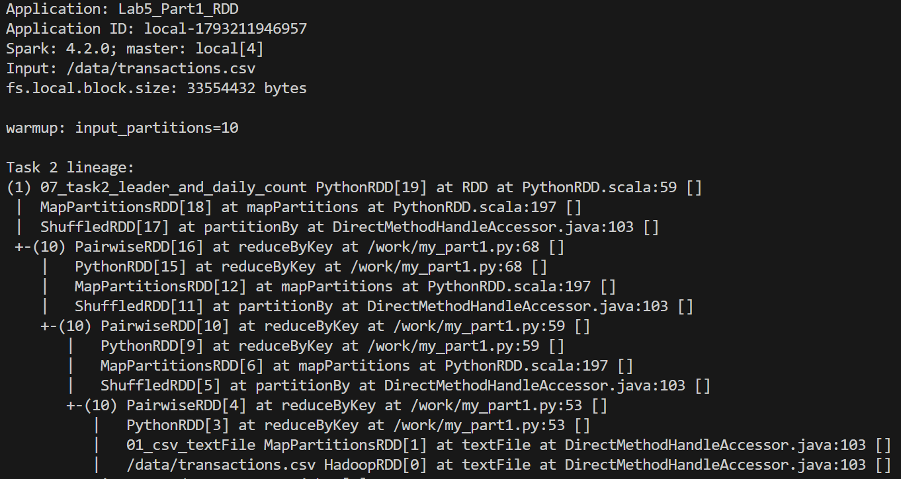

*Рисунок 1. Назва застосунку, шлях до CSV, 10 початкових розділів і lineage фінального RDD.*

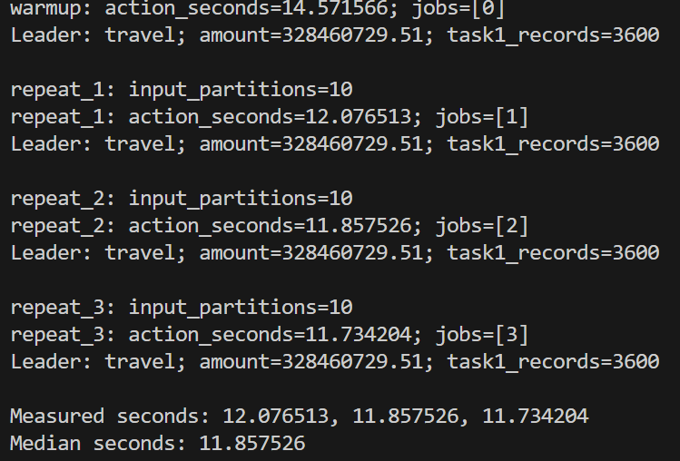

*Рисунок 2. Прогрів і три повтори. В усіх запусках отримано travel, суму 328460729,51 та 3600 денних підсумків.*

## Частина 2 — ліниві обчислення та кеш

Побудова ланцюжка не створила жодного job-а. Навмисне перетворення `category`
на число спричинило виняток під час `leader.collect()`: на driver —
`my_part2.py:119`, у функції розбору на worker — `my_part2.py:22`.
Job 4 завершився очікуваною помилкою; після її обробки експерименти продовжилися.

| Вимір | Прогрів, с | Повтор 1, с | Повтор 2, с | Повтор 3, с | Медіана, с |
|---|---:|---:|---:|---:|---:|
| Побудова ланцюжка | 0,453507 | 0,132437 | 0,099044 | 0,104434 | **0,104434** |
| Фінальна дія | 14,640883 | 11,915955 | 11,808591 | 11,817187 | **11,817187** |
| Пара дій без кешу | 22,767846 | 22,356261 | 22,264625 | 22,582096 | **22,356261** |
| Перша пара після cache() | 16,736162 | 15,587666 | 17,360489 | 18,047661 | **17,360489** |
| Наступні пари на заповненому кеші | 4,384477 | 4,097375 | 4,122094 | 4,062400 | **4,097375** |

Пара дій — `pairs.count()` і нова агрегація `pairs.reduceByKey(add).count()`.
Перша дія повертає 8000000 транзакцій, друга — 3600 денних підсумків.
Для кожного повтору без кешу та першої пари з кешем створено новий RDD.
Наступні пари використовують заповнений кеш, але щоразу будують нову агрегацію.

| Режим, перший вимірюваний повтор | Job count / агрегація | Input першого job-а, байтів | Input другого job-а, байтів | Проходів по CSV за пару |
|---|---|---:|---:|---:|
| Без кешу | 7 / 8 | 331938424 | 331938424 | 2 |
| Перша пара з кешем | 15 / 16 | 331938424 | 86216596 | 1 |
| Наступна пара з кешем | 23 / 24 | 86216596 | 86216596 | 0 |

У кеші збережено всі 10 розділів RDD пар: **86216596 байтів**, або **82,22 МіБ**;
на диску — 0 байтів. Кеш містить внутрішнє серіалізоване подання дати, категорії
та суми після розбору; `user_id` і час доби в ньому вже відсутні.
Input включає читання кешованих блоків, тому ненульовий Input сам по собі
не означає повторне читання CSV. Це також не лічильник фізичних звернень до SSD.

Перша пара з кешем у цьому запуску виявилася швидшою за пару без кешу:
17,360489 с проти 22,356261 с. Економія повторного читання та розбору переважила
витрати заповнення кешу. Наступні пари дали прискорення приблизно **5,46×**
порівняно з режимом без кешу.

Початковий вивід із traceback і метриками всіх job-ів: [part2.log](evidence/logs/part2.log).
Огляд 28 успішних job-ів та одного навмисно невдалого: [Spark Jobs, PDF](evidence/part2_jobs.pdf).

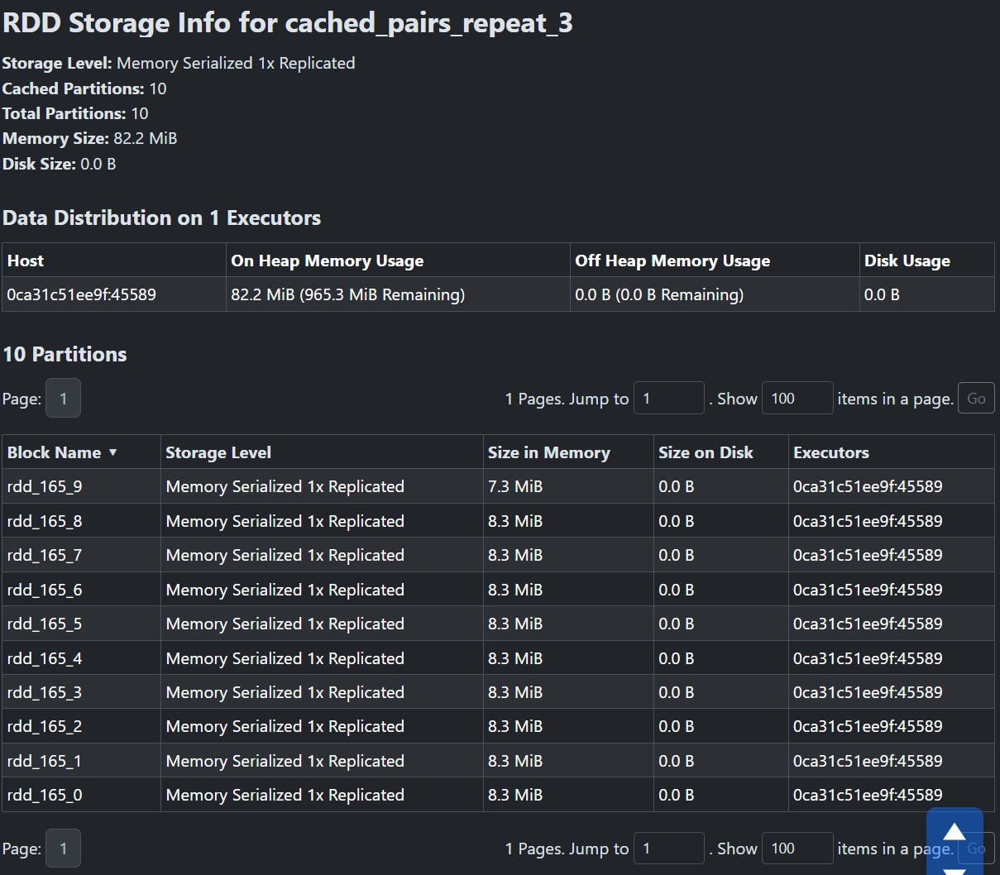

*Рисунок 3. Storage RDD 165: 10 із 10 розділів у пам'яті, 82,2 МіБ, без використання диска.*

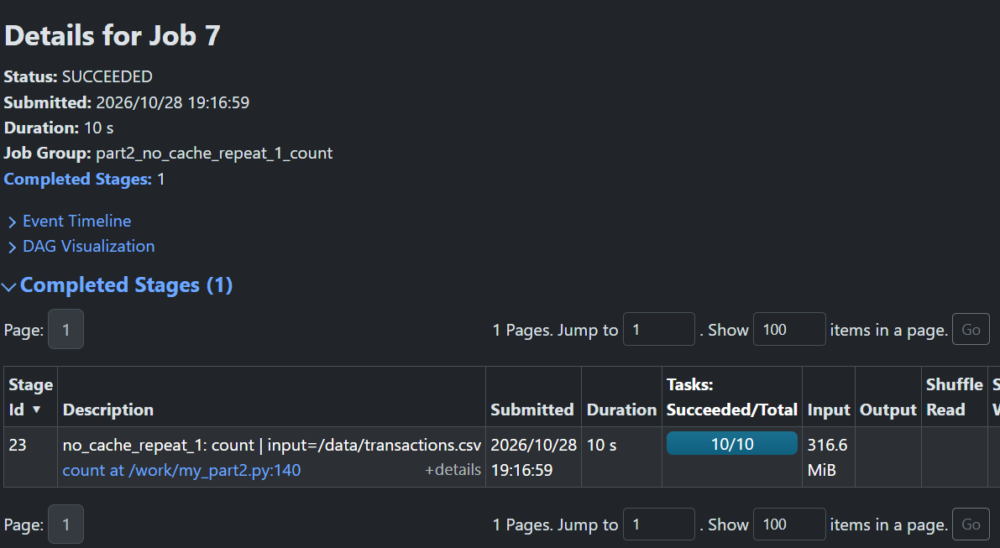

*Рисунок 4. Без кешу, перша дія count(): job 7, stage 23, Input 316,6 МіБ, 10 задач.*

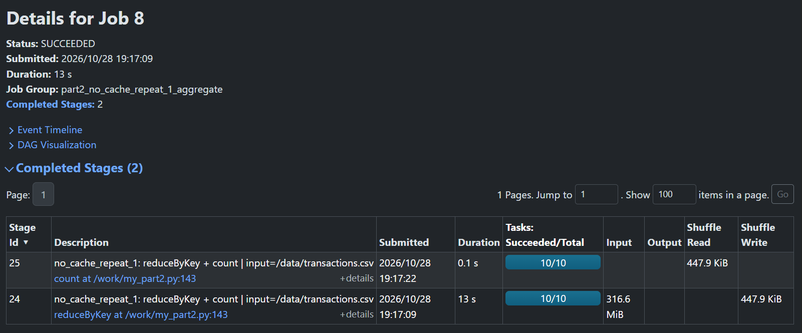

*Рисунок 5. Без кешу, друга дія: job 8, Input знову 316,6 МіБ; додатковий stage читає shuffle.*

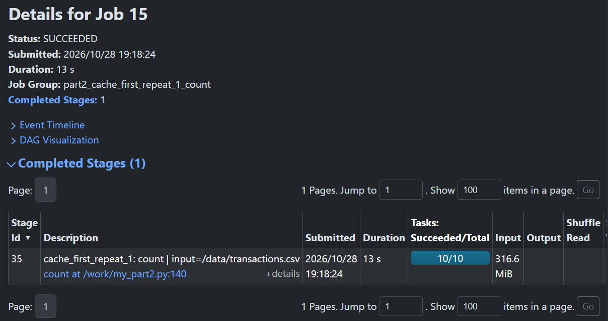

*Рисунок 6. Перша дія після cache(): job 15 читає CSV, Input 316,6 МіБ, і заповнює кеш.*

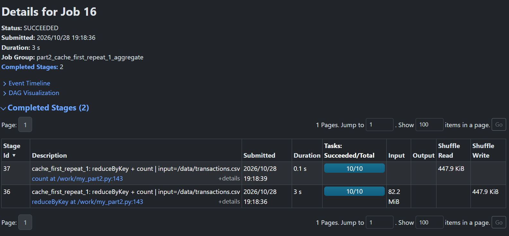

*Рисунок 7. Друга дія першої пари з кешем: job 16, Input 82,2 МіБ кешованих пар.*

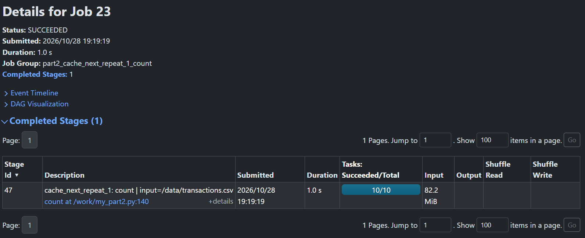

*Рисунок 8. Наступна пара, count(): job 23 читає 82,2 МіБ із заповненого кешу.*

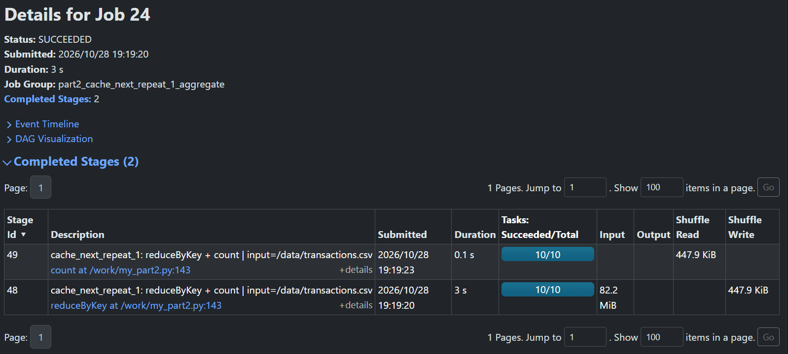

*Рисунок 9. Наступна пара, агрегація: job 24 також читає 82,2 МіБ із кешу та виконує новий shuffle.*

## Частина 3 — ядра та розділи

Для всіх шести конфігурацій використано той самий CSV і конвеєр частини 1.
Змінювалися тільки параметри `spark-submit`: `--master` та
`--conf spark.hadoop.fs.local.block.size`. Кожен повтор створює новий ланцюжок;
замір охоплює тільки фінальну дію.

| Master | Шматок, МіБ | Розділи | Задачі в job-і | Прогрів, с | Повтор 1, с | Повтор 2, с | Повтор 3, с | Медіана, с |
|---|---:|---:|---:|---:|---:|---:|---:|---:|
| local[1] | 32 | 10 | 31 | 40,402103 | 42,479357 | 38,271687 | 38,280809 | **38,280809** |
| local[2] | 32 | 10 | 31 | 20,744005 | 20,566908 | 20,316516 | 19,900852 | **20,316516** |
| local[4] | 32 | 10 | 31 | 14,171695 | 12,341498 | 11,930600 | 11,988154 | **11,988154** |
| local[1] | 128 | 3 | 10 | 39,935707 | 35,600189 | 37,100550 | 35,024645 | **35,600189** |
| local[2] | 128 | 3 | 10 | 22,952818 | 20,520521 | 20,615336 | 20,939885 | **20,615336** |
| local[4] | 128 | 3 | 10 | 15,678855 | 14,056285 | 14,588696 | 13,871979 | **14,056285** |

Зі шматком 32 МіБ `local[4]` швидший за `local[1]` приблизно в **3,19 раза**,
зі шматком 128 МіБ — у **2,53 раза**. На цьому файлі найменша медіана серед
шести конфігурацій — у `local[4]` зі шматком 32 МіБ.

У `local[4]` зі шматком 32 МіБ перший stage має 10 задач: до чотирьох одночасно,
приблизно три хвилі 4 + 4 + 2. Зі шматком 128 МіБ є три задачі читання, які
стартують однією хвилею. Максимальна паралельність цього stage — три задачі;
один із чотирьох потоків залишається без роботи. Дві більші задачі тривають
приблизно 14 с, менша завершується приблизно за 7 с.

У вкладці Executors один запис `driver` із 4 Cores. За чотири запуски виконано
124 задачі для 32 МіБ та 40 для 128 МіБ. Локальний driver і виконавець задач
працюють в одній JVM; Python-функції виконуються worker-процесами Python.

Усі значення без округлення, ID застосунків, stages і задачі збережено в
[evidence/part3/](evidence/part3/). Загальна таблиця — [results.csv](evidence/part3/results.csv),
відомості про CPU — [hardware.json](evidence/part3/hardware.json).

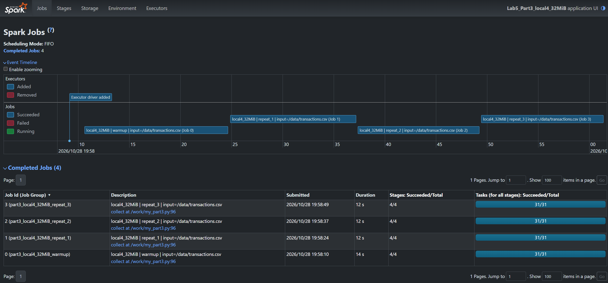

*Рисунок 10. local[4], 32 МіБ: прогрів і три повтори, по чотири stages та 31 задачі в кожному job-і.*

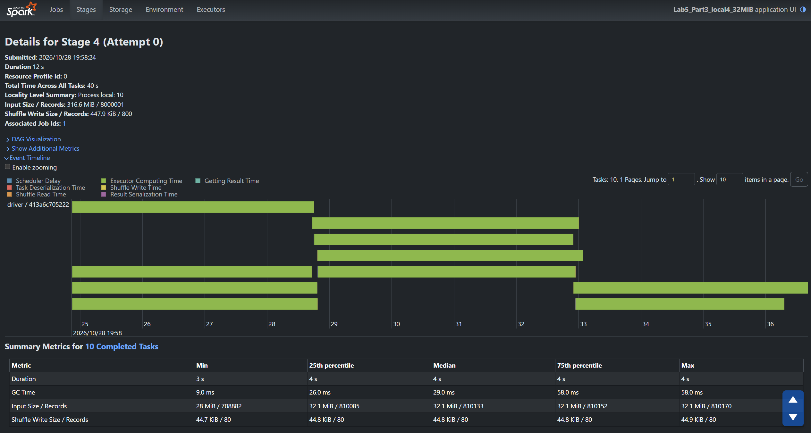

*Рисунок 11. local[4], 32 МіБ, job 1, stage 4: 10 задач читання, до чотирьох одночасно, приблизно три хвилі.*

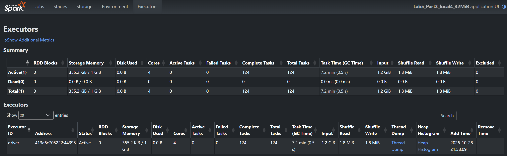

*Рисунок 12. local[4], 32 МіБ: один driver із 4 Cores, 124 завершені задачі за чотири запуски.*

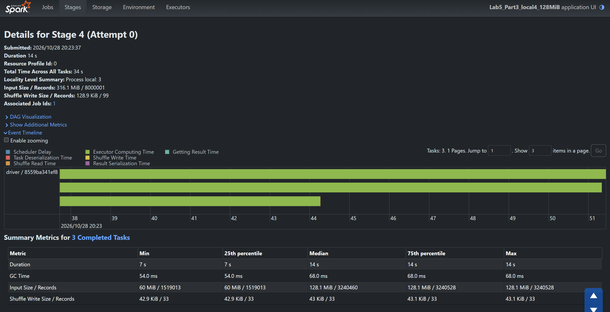

*Рисунок 13. local[4], 128 МіБ, job 1, stage 4: три задачі читання стартують однією хвилею.*

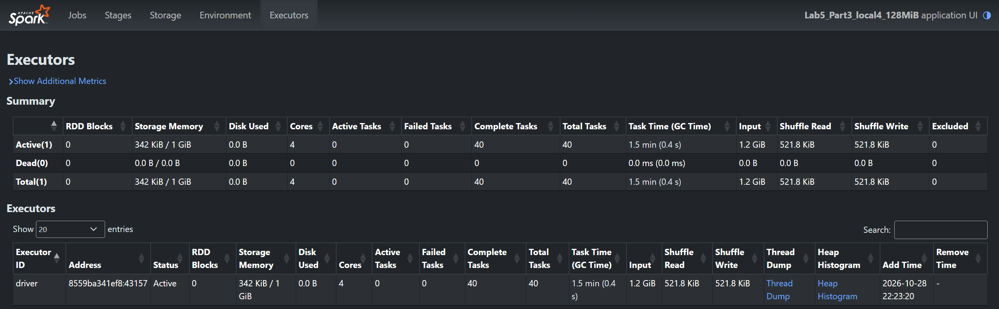

*Рисунок 14. local[4], 128 МіБ: один driver із 4 Cores, 40 завершених задач за чотири запуски.*

## Код і запуск

| Файл | Призначення |
|---|---|
| [my_part1.py](my_part1.py) | Конвеєр RDD, точні суми, лідер, кількість денних записів і lineage |
| [my_part2.py](my_part2.py) | Час побудови та дії, навмисна помилка, порівняння кешування |
| [my_part3.py](my_part3.py) | Виміри однієї конфігурації, задачі й stages, JSON із результатами |
| [run_part3.ps1](run_part3.ps1) | Шість послідовних запусків, логи UTF-8, таблиця CSV та продовження через Resume |
| [docker-compose.yml](docker-compose.yml) | Spark, History Server і спільний том журналів подій |
| [conf/spark-defaults.conf](conf/spark-defaults.conf) | Базові налаштування Spark |

Docker-конфігурацію підготовлено за вимогами завдання: архів викладача був відсутній.
CSV підключається з попередньої лабораторної лише для читання.

Команди виконуються в PowerShell із папки `Lab5_Spark_1`:

```powershell
docker compose pull
docker compose up -d --wait history

docker compose run --rm --service-ports spark spark-submit my_part1.py
docker compose run --rm --service-ports spark spark-submit my_part2.py --pause

powershell -NoProfile -ExecutionPolicy Bypass -File .\run_part3.ps1 -PauseForScreenshots
```

У частині 2 з `--pause` скрипт чекає на файл-сигнал. Після скриншотів Jobs/Stages
і Storage виконати в іншому вікні PowerShell із папки цієї лабораторної:

```powershell
New-Item -ItemType File -Path .\evidence\part2.continue -Force | Out-Null
```

У частині 3 паузу обробляє PowerShell: після скриншотів потрібно натиснути Enter.
Для продовження перерваної серії з готових JSON додати `-Resume`.
Окремий запуск, наприклад `local[4]` зі шматком 128 МіБ:

```powershell
docker compose run --rm --service-ports spark spark-submit --master "local[4]" --conf spark.hadoop.fs.local.block.size=134217728 my_part3.py
```

Spark UI під час роботи — http://localhost:4040, History Server — http://localhost:18080.
`docker compose down` зупиняє середовище; том журналів зберігається, якщо не додавати `-v`.
