# Звіт до лабораторної роботи

**Spark — stage-и, shuffle і плани запитів**

**Виконав: Вяльцев Олександр**

[GitHub — код лабораторної роботи](https://github.com/VialtsevOleksandr/Big-Data-and-DIS-Labs/tree/main/Lab5_Spark_2)

## Дані та середовище

| Параметр | Значення |
| --- | --- |
| Spark | 4.2.0 |
| Режим | `local[4]` |
| Heap | 2 ГБ |
| Транзакції | `/work2/data/transactions.csv` |
| Довідник користувачів | `/work2/data/users.csv` |
| Розмір transactions.csv, МіБ | 309,143 |
| Розмір users.csv, МіБ | 0,205 |
| Кількість транзакцій без заголовка | 8 000 000 |
| Кількість зареєстрованих користувачів | 9 000 |
| Гостьові покупки | 30% (2 400 000 транзакцій) |
| Кількість категорій | 10 |
| Кількість міст | 15 |
| Період | 360 днів, від 2026-01-01 |
| Seed | 20050406 |

## Частина 1 — RDD: stage-и та shuffle

Застосунок: `Lab5_Spark_2_Part1_GroupByKey_ReduceByKey`. ID: `local-1793841944606`.

Кількість розділів `sc.textFile`: **10**.

| Варіант | Повтор 1, с | Повтор 2, с | Повтор 3, с | Медіана, с |
| --- | --- | --- | --- | --- |
| А — groupByKey | 15,453 | 14,861 | 14,805 | 14,861 |
| Б — reduceByKey | 13,220 | 13,018 | 13,211 | 13,211 |

Метрики першого вимірюваного повтору:

| Варіант | Job ID | Job-ів | Stage ID | Stage-ів | Задач | Shuffle Write першого stage-у, МіБ |
| --- | --- | --- | --- | --- | --- | --- |
| А — groupByKey | 3 | 1 | 6, 7 | 2 | 20 | 32,093 |
| Б — reduceByKey | 2 | 1 | 4, 5 | 2 | 20 | 0,847 |

10 користувачів із найбільшою сумою:

| user_id | Кількість транзакцій | Сума amount |
| --- | --- | --- |
| 0 | 2 400 000 | 351 961 379,31 |
| 8569 | 699 | 122 502,03 |
| 4173 | 697 | 122 457,91 |
| 7787 | 649 | 119 519,52 |
| 9008 | 636 | 118 870,04 |
| 4536 | 659 | 118 506,84 |
| 5078 | 645 | 118 104,75 |
| 6690 | 669 | 117 968,06 |
| 3577 | 679 | 117 462,47 |
| 2147 | 669 | 116 723,77 |

Збіг результатів А і Б: **OK**.

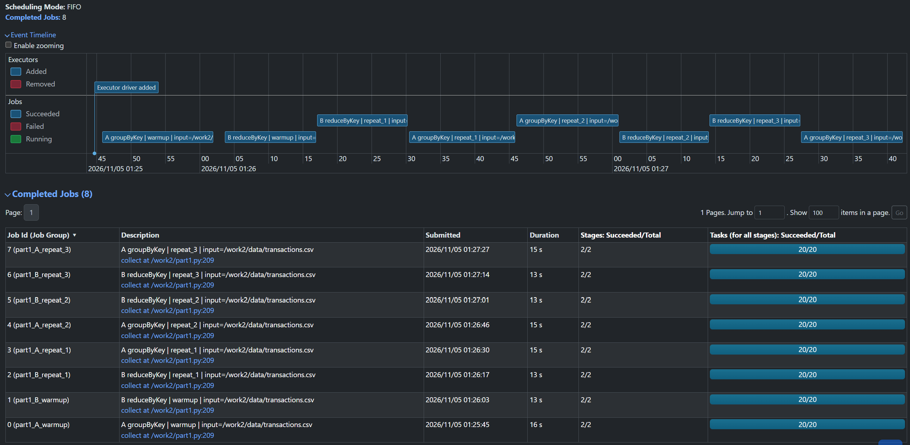

*Рисунок 1. Огляд job-ів частини 1.*

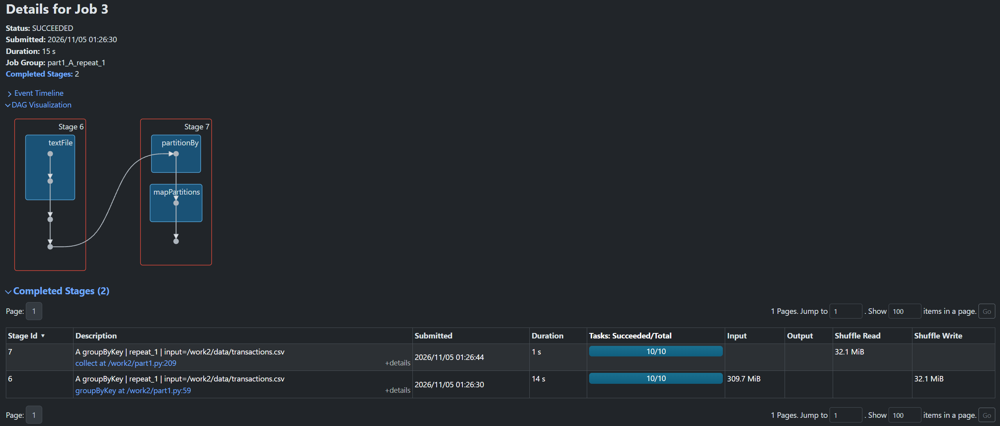

*Рисунок 2. Варіант А: groupByKey, job 3, stage-и 6 і 7.*

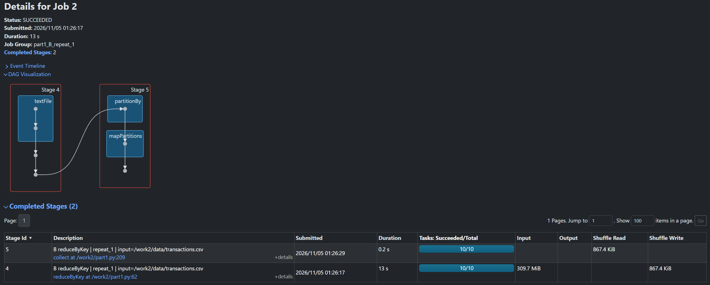

*Рисунок 3. Варіант Б: reduceByKey, job 2, stage-и 4 і 5.*

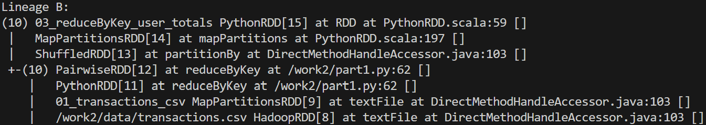

*Рисунок 4. Вивід toDebugString() варіанта Б.*

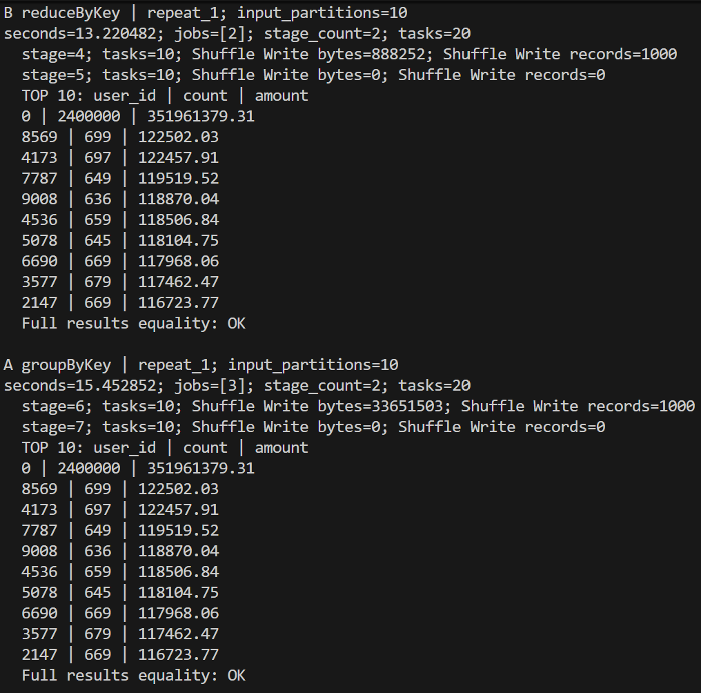

*Рисунок 5. Вивід скрипту: перший повтор варіантів А і Б.*

## Частина 2 — DataFrame: план і формат даних

Застосунок: `Lab5_Spark_2_Part2_CSV_Parquet`. ID: `local-1793842903787`.

Запит: 5 днів із найбільшою виручкою в категорії `books`.

| Джерело | Розмір на диску, МіБ | Повтор 1, с | Повтор 2, с | Повтор 3, с | Медіана, с |
| --- | --- | --- | --- | --- | --- |
| CSV | 309,143 | 3,965 | 3,845 | 3,947 | 3,947 |
| Parquet | 105,248 | 0,859 | 0,845 | 0,918 | 0,859 |
| Parquet за категоріями | 107,073 | 0,303 | 0,289 | 0,276 | 0,289 |

Метрики Scan першого вимірюваного повтору:

| Джерело | SQL ID | number of files read | size of files read, МіБ | number of output rows |
| --- | --- | --- | --- | --- |
| CSV | 7 | 1 | 309,143 | 481 269 |
| Parquet | 5 | 4 | 104,432 | 8 000 000 |
| Parquet за категоріями | 6 | 4 | 6,486 | 481 269 |

| Дата | Виручка |
| --- | --- |
| 2026-03-07 | 47 383,76 |
| 2026-07-05 | 46 564,94 |
| 2026-12-15 | 46 536,28 |
| 2026-08-10 | 46 483,50 |
| 2026-02-18 | 46 162,17 |

Збіг результатів CSV, Parquet і Parquet за категоріями: **OK**.

### CSV

```text
AdaptiveSparkPlan isFinalPlan=true
+- == Final Plan ==
   ResultQueryStage 1
   +- TakeOrderedAndProject(limit=5, orderBy=[revenue#128 DESC NULLS LAST,date#127 ASC NULLS FIRST], output=[date#127,revenue#128])
      +- *(2) HashAggregate(keys=[_groupingexpression#134], functions=[sum(amount#125)], output=[date#127, revenue#128])
         +- AQEShuffleRead coalesced
            +- ShuffleQueryStage 0
               +- Exchange hashpartitioning(_groupingexpression#134, 200), ENSURE_REQUIREMENTS, [plan_id=383]
                  +- *(1) HashAggregate(keys=[_groupingexpression#134], functions=[partial_sum(amount#125)], output=[_groupingexpression#134, sum#137, isEmpty#138])
                     +- *(1) Project [amount#125, cast(timestamp#123 as date) AS _groupingexpression#134]
                        +- *(1) Filter (isnotnull(category#124) AND (category#124 = books))
                           +- FileScan csv [timestamp#123,category#124,amount#125] Batched: false, DataFilters: [isnotnull(category#124), (category#124 = books)], Format: CSV, Location: InMemoryFileIndex(1 paths)[file:/work2/data/transactions.csv], PartitionFilters: [], PushedFilters: [IsNotNull(category), EqualTo(category,books)], ReadSchema: struct<timestamp:timestamp,category:string,amount:decimal(18,2)>
```

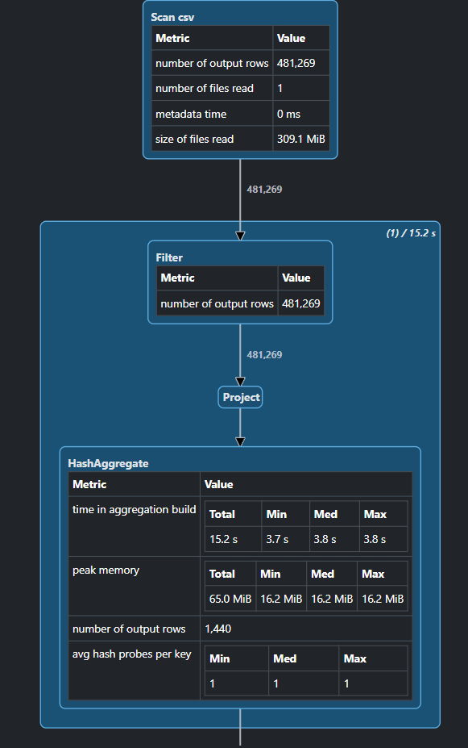

*Рисунок 6. CSV: метрики Scan.*

### Parquet

```text
AdaptiveSparkPlan isFinalPlan=true
+- == Final Plan ==
   ResultQueryStage 1
   +- TakeOrderedAndProject(limit=5, orderBy=[revenue#86 DESC NULLS LAST,date#85 ASC NULLS FIRST], output=[date#85,revenue#86])
      +- *(2) HashAggregate(keys=[_groupingexpression#92], functions=[sum(amount#83)], output=[date#85, revenue#86])
         +- AQEShuffleRead coalesced
            +- ShuffleQueryStage 0
               +- Exchange hashpartitioning(_groupingexpression#92, 200), ENSURE_REQUIREMENTS, [plan_id=263]
                  +- *(1) HashAggregate(keys=[_groupingexpression#92], functions=[partial_sum(amount#83)], output=[_groupingexpression#92, sum#95, isEmpty#96])
                     +- *(1) Project [amount#83, cast(timestamp#81 as date) AS _groupingexpression#92]
                        +- *(1) Filter (isnotnull(category#82) AND (category#82 = books))
                           +- *(1) ColumnarToRow
                              +- FileScan parquet [timestamp#81,category#82,amount#83] Batched: true, DataFilters: [isnotnull(category#82), (category#82 = books)], Format: Parquet, Location: InMemoryFileIndex(1 paths)[file:/work2/data/tx.parquet], PartitionFilters: [], PushedFilters: [IsNotNull(category), EqualTo(category,books)], ReadSchema: struct<timestamp:timestamp,category:string,amount:decimal(18,2)>
```

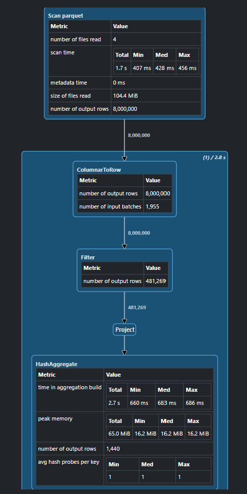

*Рисунок 7. Parquet: метрики Scan.*

### Parquet за категоріями

```text
AdaptiveSparkPlan isFinalPlan=true
+- == Final Plan ==
   ResultQueryStage 1
   +- TakeOrderedAndProject(limit=5, orderBy=[revenue#107 DESC NULLS LAST,date#106 ASC NULLS FIRST], output=[date#106,revenue#107])
      +- *(2) HashAggregate(keys=[_groupingexpression#113], functions=[sum(amount#103)], output=[date#106, revenue#107])
         +- AQEShuffleRead coalesced
            +- ShuffleQueryStage 0
               +- Exchange hashpartitioning(_groupingexpression#113, 200), ENSURE_REQUIREMENTS, [plan_id=324]
                  +- *(1) HashAggregate(keys=[_groupingexpression#113], functions=[partial_sum(amount#103)], output=[_groupingexpression#113, sum#116, isEmpty#117])
                     +- *(1) Project [amount#103, cast(timestamp#102 as date) AS _groupingexpression#113]
                        +- *(1) ColumnarToRow
                           +- FileScan parquet [timestamp#102,amount#103,category#104] Batched: true, DataFilters: [], Format: Parquet, Location: InMemoryFileIndex(1 paths)[file:/work2/data/tx_by_category.parquet], PartitionFilters: [isnotnull(category#104), (category#104 = books)], PushedFilters: [], ReadSchema: struct<timestamp:timestamp,amount:decimal(18,2)>
```

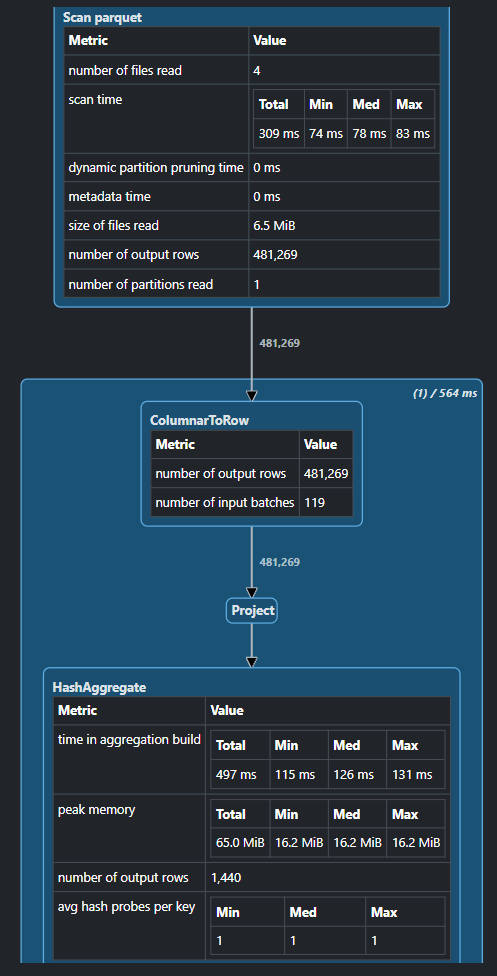

*Рисунок 8. Parquet за категоріями: метрики Scan.*

## Частина 3 — join і перекіс даних

Запит: виручка за містами; inner join `/work2/data/tx.parquet` і `/work2/data/users.csv` за `user_id`.

| Запуск | Застосунок | Application ID |
| --- | --- | --- |
| а | Lab5_Spark_2_Part3_A | local-1793846380548 |
| б | Lab5_Spark_2_Part3_B | local-1793846429376 |
| в | Lab5_Spark_2_Part3_C | local-1793846464545 |

| Налаштування | Запуск а | Запуск б | Запуск в |
| --- | --- | --- | --- |
| `spark.sql.autoBroadcastJoinThreshold`, МіБ | 10,000 | -1 (вимкнено) | -1 (вимкнено) |
| `spark.sql.adaptive.enabled` | true | false | false |
| `spark.sql.shuffle.partitions` | 200 | 8 | 8 |

| Запуск | Повтор 1, с | Повтор 2, с | Повтор 3, с | Медіана, с |
| --- | --- | --- | --- | --- |
| а | 1,201 | 1,053 | 0,991 | 1,053 |
| б | 2,758 | 2,529 | 2,531 | 2,531 |
| в | 1,813 | 1,712 | 1,672 | 1,712 |

Сумарний Shuffle Write першого вимірюваного повтору:

| Запуск | Shuffle Write, МіБ |
| --- | --- |
| а | 0,005 |
| б | 68,649 |
| в | 53,561 |

### Запуск а

```text
AdaptiveSparkPlan isFinalPlan=true
+- == Final Plan ==
   ResultQueryStage 2
   +- *(3) HashAggregate(keys=[city#31], functions=[sum(amount#29)], output=[city#31, revenue#35])
      +- AQEShuffleRead coalesced
         +- ShuffleQueryStage 1
            +- Exchange hashpartitioning(city#31, 200), ENSURE_REQUIREMENTS, [plan_id=258]
               +- *(2) HashAggregate(keys=[city#31], functions=[partial_sum(amount#29)], output=[city#31, sum#42, isEmpty#43])
                  +- *(2) Project [amount#29, city#31]
                     +- *(2) BroadcastHashJoin [user_id#26L], [user_id#30L], Inner, BuildRight, false, false
                        :- *(2) Filter isnotnull(user_id#26L)
                        :  +- *(2) ColumnarToRow
                        :     +- FileScan parquet [user_id#26L,amount#29] Batched: true, DataFilters: [isnotnull(user_id#26L)], Format: Parquet, Location: InMemoryFileIndex(1 paths)[file:/work2/data/tx.parquet], PartitionFilters: [], PushedFilters: [IsNotNull(user_id)], ReadSchema: struct<user_id:bigint,amount:decimal(18,2)>
                        +- BroadcastQueryStage 0
                           +- BroadcastExchange HashedRelationBroadcastMode(List(input[0, bigint, false]),false), [plan_id=201]
                              +- *(1) Filter isnotnull(user_id#30L)
                                 +- FileScan csv [user_id#30L,city#31] Batched: false, DataFilters: [isnotnull(user_id#30L)], Format: CSV, Location: InMemoryFileIndex(1 paths)[file:/work2/data/users.csv], PartitionFilters: [], PushedFilters: [IsNotNull(user_id)], ReadSchema: struct<user_id:bigint,city:string>
```

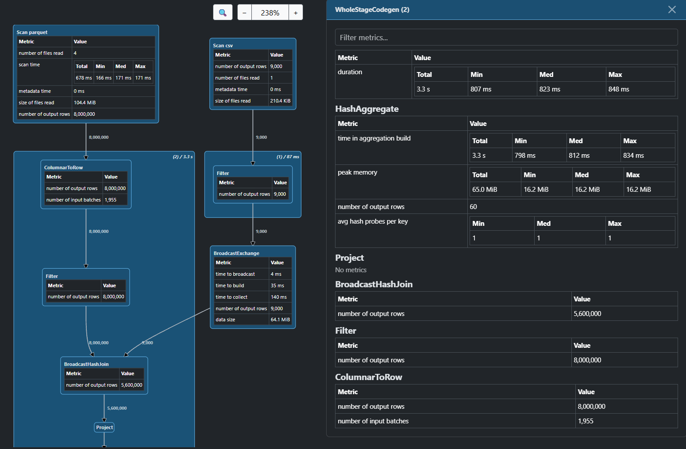

*Рисунок 9. Запуск а: BroadcastHashJoin.*

### Запуск б

```text
*(6) HashAggregate(keys=[city#27], functions=[sum(amount#25)], output=[city#27, revenue#31])
+- Exchange hashpartitioning(city#27, 8), ENSURE_REQUIREMENTS, [plan_id=188]
   +- *(5) HashAggregate(keys=[city#27], functions=[partial_sum(amount#25)], output=[city#27, sum#38, isEmpty#39])
      +- *(5) Project [amount#25, city#27]
         +- *(5) SortMergeJoin [user_id#22L], [user_id#26L], Inner
            :- *(2) Sort [user_id#22L ASC NULLS FIRST], false, 0
            :  +- Exchange hashpartitioning(user_id#22L, 8), ENSURE_REQUIREMENTS, [plan_id=171]
            :     +- *(1) Filter isnotnull(user_id#22L)
            :        +- *(1) ColumnarToRow
            :           +- FileScan parquet [user_id#22L,amount#25] Batched: true, DataFilters: [isnotnull(user_id#22L)], Format: Parquet, Location: InMemoryFileIndex(1 paths)[file:/work2/data/tx.parquet], PartitionFilters: [], PushedFilters: [IsNotNull(user_id)], ReadSchema: struct<user_id:bigint,amount:decimal(18,2)>
            +- *(4) Sort [user_id#26L ASC NULLS FIRST], false, 0
               +- Exchange hashpartitioning(user_id#26L, 8), ENSURE_REQUIREMENTS, [plan_id=179]
                  +- *(3) Filter isnotnull(user_id#26L)
                     +- FileScan csv [user_id#26L,city#27] Batched: false, DataFilters: [isnotnull(user_id#26L)], Format: CSV, Location: InMemoryFileIndex(1 paths)[file:/work2/data/users.csv], PartitionFilters: [], PushedFilters: [IsNotNull(user_id)], ReadSchema: struct<user_id:bigint,city:string>
```

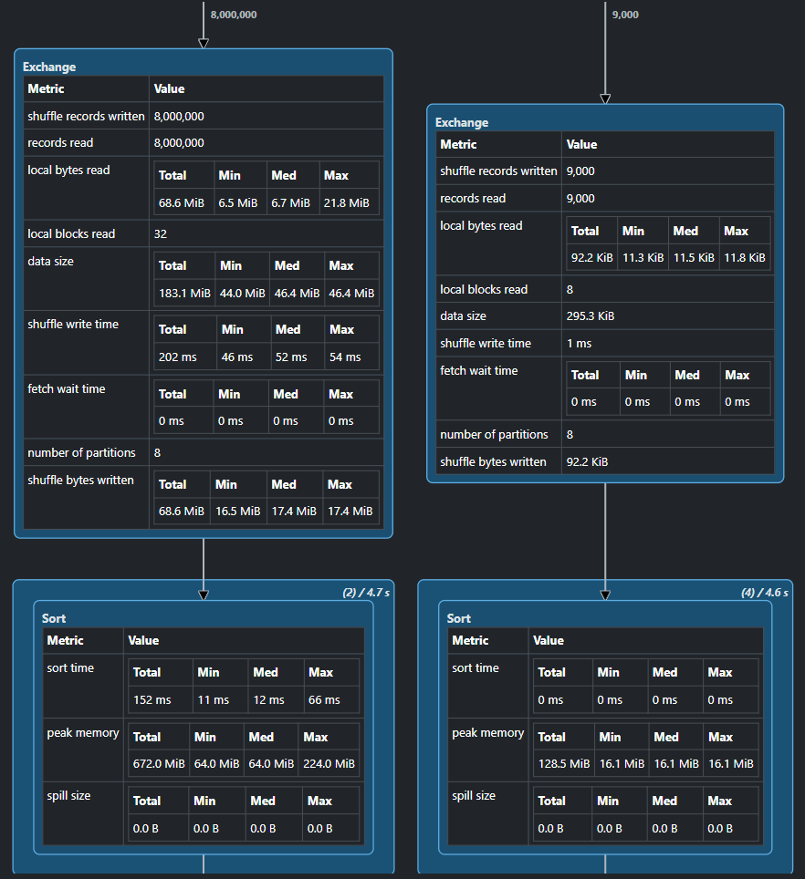

*Рисунок 10. Запуск б: Exchange і Sort перед join.*

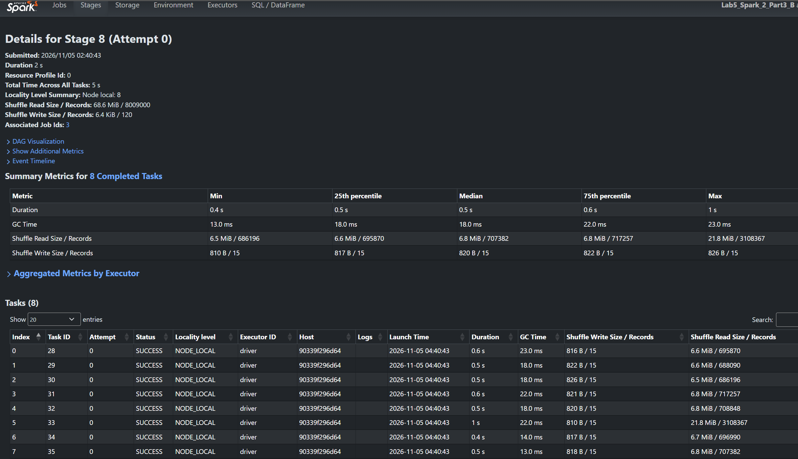

*Рисунок 11. Запуск б: stage 8, метрики восьми задач.*

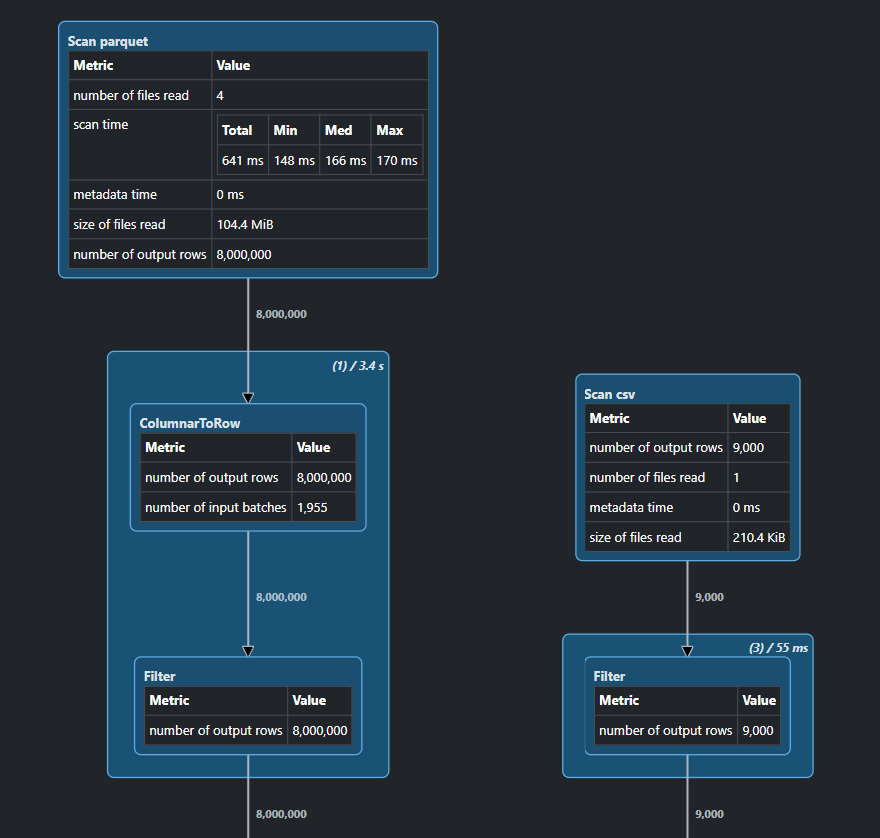

*Рисунок 12. Запуск б: Scan перед shuffle.*

### Запуск в

```text
*(6) HashAggregate(keys=[city#27], functions=[sum(amount#25)], output=[city#27, revenue#31])
+- Exchange hashpartitioning(city#27, 8), ENSURE_REQUIREMENTS, [plan_id=188]
   +- *(5) HashAggregate(keys=[city#27], functions=[partial_sum(amount#25)], output=[city#27, sum#38, isEmpty#39])
      +- *(5) Project [amount#25, city#27]
         +- *(5) SortMergeJoin [user_id#22L], [user_id#26L], Inner
            :- *(2) Sort [user_id#22L ASC NULLS FIRST], false, 0
            :  +- Exchange hashpartitioning(user_id#22L, 8), ENSURE_REQUIREMENTS, [plan_id=171]
            :     +- *(1) Filter (isnotnull(user_id#22L) AND NOT (user_id#22L = 0))
            :        +- *(1) ColumnarToRow
            :           +- FileScan parquet [user_id#22L,amount#25] Batched: true, DataFilters: [isnotnull(user_id#22L), NOT (user_id#22L = 0)], Format: Parquet, Location: InMemoryFileIndex(1 paths)[file:/work2/data/tx.parquet], PartitionFilters: [], PushedFilters: [IsNotNull(user_id), Not(EqualTo(user_id,0))], ReadSchema: struct<user_id:bigint,amount:decimal(18,2)>
            +- *(4) Sort [user_id#26L ASC NULLS FIRST], false, 0
               +- Exchange hashpartitioning(user_id#26L, 8), ENSURE_REQUIREMENTS, [plan_id=179]
                  +- *(3) Filter (NOT (user_id#26L = 0) AND isnotnull(user_id#26L))
                     +- FileScan csv [user_id#26L,city#27] Batched: false, DataFilters: [NOT (user_id#26L = 0), isnotnull(user_id#26L)], Format: CSV, Location: InMemoryFileIndex(1 paths)[file:/work2/data/users.csv], PartitionFilters: [], PushedFilters: [Not(EqualTo(user_id,0)), IsNotNull(user_id)], ReadSchema: struct<user_id:bigint,city:string>
```

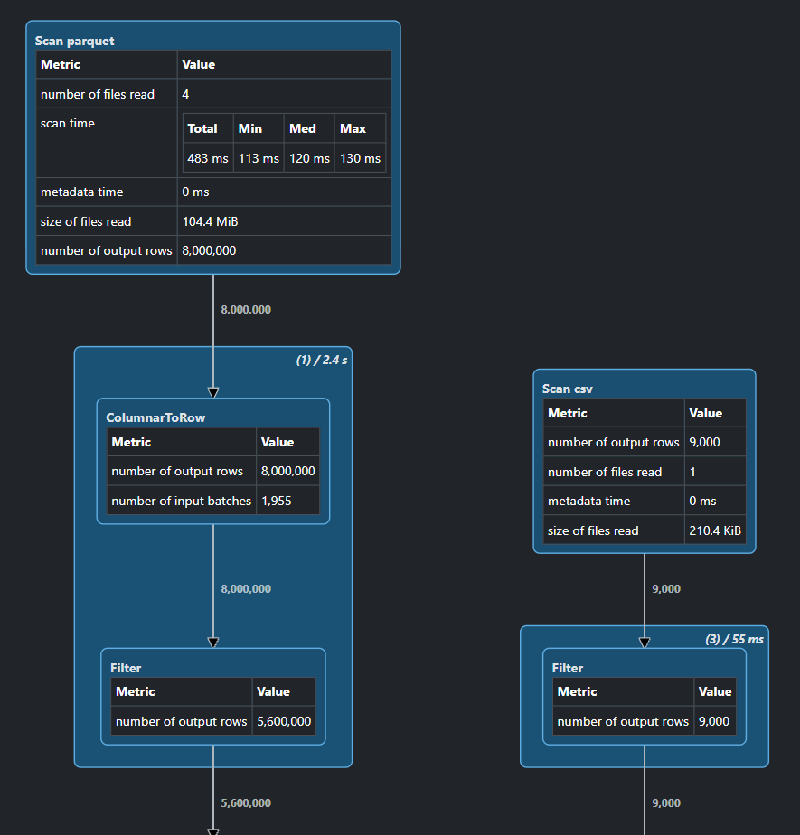

*Рисунок 13. Запуск в: фільтр гостьових покупок перед shuffle.*

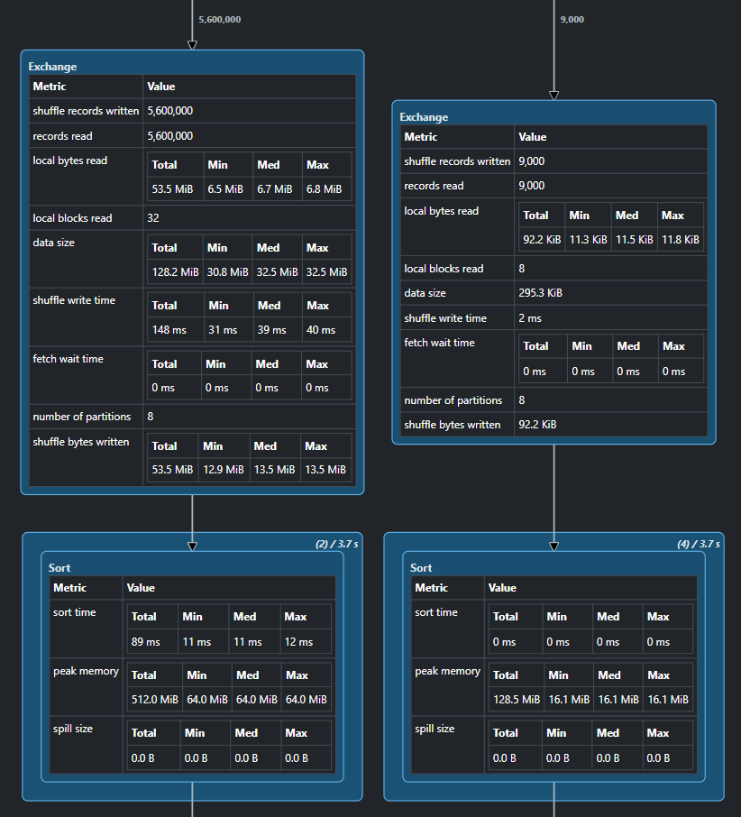

*Рисунок 14. Запуск в: Exchange і Sort перед join.*

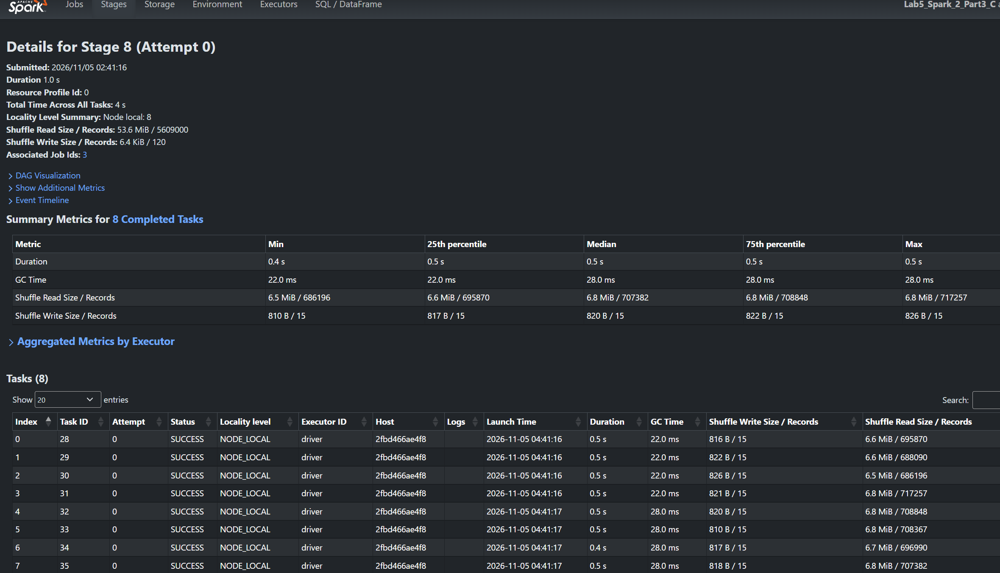

*Рисунок 15. Запуск в: stage 8, метрики восьми задач.*

### Shuffle Read Records

Перший вимірюваний повтор, stage 8 у запусках б і в:

| Індекс задачі | Запуск б: Shuffle Read Records | Запуск в: Shuffle Read Records |
| --- | --- | --- |
| 0 | 695 870 | 695 870 |
| 1 | 688 090 | 688 090 |
| 2 | 686 196 | 686 196 |
| 3 | 717 257 | 717 257 |
| 4 | 708 848 | 708 848 |
| 5 | 3 108 367 | 708 367 |
| 6 | 696 990 | 696 990 |
| 7 | 707 382 | 707 382 |

### Результати запитів

| Місто | Виручка |
| --- | --- |
| Cherkasy | 54 819 918,24 |
| Chernihiv | 54 935 957,08 |
| Dnipro | 54 853 393,04 |
| Ivano-Frankivsk | 54 388 400,72 |
| Kharkiv | 54 777 737,68 |
| Kyiv | 54 845 804,47 |
| Lutsk | 54 574 010,37 |
| Lviv | 55 034 200,01 |
| Odesa | 54 874 091,50 |
| Poltava | 54 490 979,26 |
| Rivne | 54 994 977,71 |
| Sumy | 54 363 989,83 |
| Ternopil | 54 617 180,18 |
| Vinnytsia | 54 791 265,98 |
| Zhytomyr | 54 962 451,38 |

Збіг результатів запусків а, б і в: **OK**.

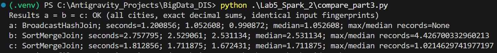

*Рисунок 16. Вивід порівняння запусків а, б і в.*

## Питання до звіту

1. Які параметри ваших даних: розмір файлу в байтах, кількість рядків, кількість користувачів, обрана частка гостьових покупок, seed? Скільки розділів дав `sc.textFile` і як це число пояснюється розрахунком? Скільки розділів було б для цього самого файлу в HDFS з блоком 128 МБ?

    Файл `transactions.csv` займає 324 159 809 байтів, або 309,143 МіБ, і містить 8 000 000 транзакцій без заголовка. Зареєстрованих користувачів — 9 000, гостьових покупок — 30%, тобто 2 400 000. Seed генератора — 20050406. У даних є 10 категорій і 360 днів, а в довіднику користувачів — 15 міст.

    `sc.textFile` створив 10 розділів. У середовищі задано розмір локального блоку 33 554 432 байти, тобто 32 МіБ. Для цього файлу отримуємо 309,143 / 32 ≈ 9,661: дев’ять повних частин і залишок утворюють 10 розділів. За тих самих умов читання з HDFS із блоком 128 МіБ було б 3 розділи: 309,143 / 128 ≈ 2,415.

2. Скільки job-ів, stage-ів і задач показав Spark UI для варіантів А і Б частини 1? Чому stage-ів саме стільки та на яких рядках вашого коду проходить межа? Де ця межа у виводі `toDebugString()`?

    В обох варіантах один вимірюваний запуск створив 1 job, 2 stage-и та 20 задач: по 10 задач у кожному stage-і. У першому повторі варіант А мав job 3 і stage-и 6 та 7, а варіант Б — job 2 і stage-и 4 та 5.

    Межа виникає під час перерозподілу даних за `user_id`: у варіанті А це `groupByKey` у рядку 59 файлу `part1.py`, у варіанті Б — `reduceByKey` у рядку 62. Читання, фільтрація заголовка та `map` виконуються до цієї межі, а остаточне зведення значень — після неї. У `toDebugString()` це видно за `ShuffledRDD[13]` і переходом `+-(10) PairwiseRDD[12]`, який посилається на `part1.py:62`. Вивід lineage наведено на рисунку 4.

3. Яким було значення Shuffle Write у варіантах А і Б і у скільки разів вони відрізняються? Скільки пар пішло в shuffle у варіанті Б за розрахунком на основі кількості ваших користувачів і розділів? Який час показав кожен варіант? Чи відрізняється час так само сильно, як обсяг shuffle, і чому?

    Shuffle Write першого stage-у становив 32,093 МіБ для `groupByKey` та 0,847 МіБ для `reduceByKey`. За початковими значеннями з логів різниця дорівнює приблизно 37,885 раза. У варіанті Б значення одного користувача спочатку підсумовуються всередині кожного вхідного розділу. Тому для 9 001 ключа, включно з гостями, і 10 розділів верхня оцінка — 9 001 × 10 = 90 010 часткових пар. Це логічні пари; лічильник Shuffle Write Records у PySpark може рахувати пакети серіалізованих даних.

    Часи варіанта А — 15,453; 14,861; 14,805 с, медіана — 14,861 с. Для Б — 13,220; 13,018; 13,211 с, медіана — 13,211 с. Прискорення становило приблизно 1,125 раза. Обсяг shuffle зменшився значно сильніше, ніж час, оскільки обидва варіанти все одно читають і розбирають 8 000 000 CSV-рядків та виконують Python-функції. На цьому локальному запуску shuffle становить лише частину загальних витрат.

4. Які 5 послідовних рядків вашого файлу обрано та які це номери рядків, наприклад 100–104? Які пари з них утворюються після `map`? Що з цих п’яти рядків потрапить у shuffle у варіанті А і що — у варіанті Б, якщо вважати, що вони лежать в одному розділі?

    Обрано рядки 100–104, якщо заголовок рахувати першим рядком файлу:

    ```text
    1064,2026-02-16T15:19:14,groceries,89.61
    1065,2026-09-28T19:46:42,books,14.20
    0,2026-11-19T05:11:42,transport,56.05
    0,2026-10-26T02:41:11,restaurants,81.96
    1066,2026-08-08T21:22:55,groceries,117.75
    ```

    Після `map` утворюються пари `(1064, (1, 8961))`, `(1065, (1, 1420))`, `(0, (1, 5605))`, `(0, (1, 8196))` та `(1066, (1, 11775))`. Перше значення в дужках — кількість транзакцій, друге — сума в копійках.

    У варіанті А в shuffle передаються всі п’ять значень для подальшої обробки груп. У варіанті Б дві гостьові покупки в одному розділі об’єднуються в `(0, (2, 13801))`. Отже, внесок цих п’яти рядків у shuffle варіанта Б — чотири часткові пари. Якщо в цьому розділі є інші покупки тих самих користувачів, вони також увійдуть у відповідні часткові підсумки.

5. Які три плани отримано в частині 2? Де в кожному відбувається shuffle і що написано в ReadSchema, PushedFilters і PartitionFilters? Які розмір на диску, час, number of files read, size of files read і number of output rows вузла Scan для кожного джерела? Чому в одного з джерел Scan віддає всі рядки файлу, хоча фільтр у плані позначено як переданий джерелу? Чому розбитий на каталоги Parquet прочитав менше байтів?

    Три фізичні плани наведено в частині 2 для CSV, звичайного Parquet і Parquet за категоріями. У кожному shuffle позначено вузлом `Exchange hashpartitioning(_groupingexpression, 200)` між частковою та остаточною агрегаціями за датою. У кінцевих планах AQE об’єднав дрібні shuffle-розділи, що видно за `AQEShuffleRead coalesced`.

    Для CSV і звичайного Parquet `ReadSchema` має вигляд `struct<timestamp:timestamp,category:string,amount:decimal(18,2)>`, `PushedFilters` — `[IsNotNull(category), EqualTo(category,books)]`, а `PartitionFilters` порожній. Для Parquet за категоріями `ReadSchema` містить лише `timestamp` та `amount`, `PushedFilters` порожній, а `PartitionFilters` містить `isnotnull(category)` і `category = books`. Значення категорії тут береться з назви каталогу.

    Розміри на диску, усі три виміри часу, медіани й метрики Scan наведено в таблицях частини 2. CSV займає 309,143 МіБ, звичайний Parquet — 105,248 МіБ, Parquet за категоріями — 107,073 МіБ. Медіани часу становлять відповідно 3,947; 0,859 та 0,289 с. Scan прочитав 1, 4 і 4 файли, сумарні розміри яких — 309,143; 104,432 та 6,486 МіБ. Кількість вихідних рядків Scan — 481 269, 8 000 000 і 481 269 відповідно.

    Звичайний Parquet віддав усі 8 000 000 рядків, хоча фільтр був переданий джерелу. У цьому запуску ввімкнено векторизоване читання, а категорії перемішані всередині даних: фільтр не дозволив відкинути групи рядків, і точний відбір виконав наступний вузол `Filter`. Parquet за категоріями одразу вибрав каталог `category=books`, тому Scan охопив лише файли цієї категорії. Метрика size of files read показує сумарний розмір вибраних файлів, а не точну кількість фізично прочитаних із диска байтів.

6. Який спосіб join обрав Spark у запусках а і б частини 3? За якими рядками плану це видно? Чому в запуску а він обрав саме цей спосіб і як розмір вашого `users.csv` співвідноситься з відповідним порогом? Скільки shuffle-ів у кожному з двох планів і який час?

    У запуску а Spark обрав `BroadcastHashJoin`, що видно за рядком `BroadcastHashJoin ... Inner, BuildRight` і вузлом `BroadcastExchange` для довідника. Файл `users.csv` займає 0,205 МіБ, що значно менше порога автоматичного broadcast — 10,000 МіБ. Оцінка розміру довідника в плані також нижча за цей поріг.

    У запуску б використано `SortMergeJoin`: перед ним є `Sort` та `Exchange hashpartitioning(user_id, 8)` з обох боків. У плані а є один shuffle — для підсумовування за містами; `BroadcastExchange` є окремою розсилкою довідника. У плані б є три shuffle-и: два перед join і один перед остаточною агрегацією за містами.

    Часи запуску а — 1,201; 1,053; 0,991 с, медіана — 1,053 с. Для запуску б — 2,758; 2,529; 2,531 с, медіана — 2,531 с.

7. Які значення Shuffle Read Records восьми задач у запусках б і в? У скільки разів найбільша задача відрізнялася від медіанної до виправлення і після? Як розмір найбільшої задачі узгоджується з обраною часткою гостьових покупок за розрахунком? Що саме ви змінили в запиті і чому результат лишився тим самим? Як змінилися час і Shuffle Write?

    Значення Shuffle Read Records усіх восьми задач наведено в таблиці частини 3. До виправлення найбільша задача прочитала 3 108 367 записів, а медіана становила 702 186. Відношення — приблизно 4,427 раза. Після виправлення максимум дорівнював 717 257 записам за тієї самої медіани, тобто приблизно 1,021 раза.

    Усі 2 400 000 гостьових транзакцій мають ключ `0` і потрапляють в один розділ. Якщо решта даних розподіляється приблизно рівномірно, очікувана кількість записів найбільшої задачі дорівнює 2 400 000 + 5 600 000 / 8 + 9 000 / 8 ≈ 3 101 125. Виміряні 3 108 367 близькі до цієї оцінки; різниця пов’язана з розподілом інших ключів між розділами.

    У запуску в перед join додано `filter(F.col("user_id") != 0)`. Гостей немає в довіднику, тому inner join усе одно відкидав би їх. Раннє вилучення цих рядків зберегло результат і прибрало найбільше скупчення одного ключа ще до shuffle. Точний збіг результатів а, б і в перевірено скриптом.

    Часи запуску в — 1,813; 1,712; 1,672 с, медіана — 1,712 с проти 2,531 с у б. Сумарний Shuffle Write зменшився з 68,649 до 53,561 МіБ. Обсяг shuffle із двох джерел перед join зменшився з 68,643 до 53,555 МіБ.

8. Якби в запуску б ви поставили `spark.sql.shuffle.partitions` = 800 замість 8 — скільки записів прочитала б найбільша задача за числовою оцінкою для ваших даних і чому?

    За 800 розділів усі 2 400 000 гостьових транзакцій однаково залишилися б разом, оскільки мають один ключ. Для інших записів середня частка на розділ стала б меншою. Оцінка для найбільшої задачі: 2 400 000 + 5 600 000 / 800 + 9 000 / 800 ≈ 2 407 011 записів.

    Це розрахункова оцінка, оскільки конкретний набір інших ключів залежить від хешування. Збільшення кількості розділів зменшило б звичайні задачі, але не розділило б самі гостьові покупки.

9. У запуску б ви вимкнули AQE. Якби його лишили ввімкненим, а broadcast — вимкненим, чи розбив би Spark ваш перекошений розділ? Як розмір вашого найбільшого розділу співвідноситься з двома умовами, за якими AQE вважає розділ перекошеним? Якими мали б бути ваші дані, щоб це спрацювало?

    За стандартних порогів AQE не розбив би цей розділ. Для визнання перекосу мають одночасно виконуватися дві умови: розмір розділу перевищує 256 МіБ і перевищує медіанний розмір розділів відповідної сторони join більш ніж у 5 разів.

    Найбільша задача в б прочитала лише 21,845 МіБ сумарно з обох сторін join. Отже, навіть увесь цей обсяг набагато менший за поріг 256 МіБ. За виміряними сумарними обсягами читання медіана становила 6,705 МіБ, а п’ятикратна медіана — 33,524 МіБ; максимум також нижчий за цю оцінку. AQE перевіряє кожну сторону окремо, тому сумарні метрики задач тут є орієнтиром, але вже невиконання порога 256 МіБ достатньо для висновку.

    Дані мали б створювати значно більший розділ і сильнішу різницю з іншими. Наприклад, розділ 300 МіБ за медіани 40 МіБ виконав би обидві умови: 300 > 256 і 300 > 5 × 40. Просте пропорційне збільшення всіх даних зберігає співвідношення розмірів, тому потрібне також сильніше скупчення записів на окремих ключах.

10. Якби довідник користувачів мав 200 млн рядків і займав кілька гігабайтів — який спосіб join обрав би Spark у запуску а? Що сталося б, якби ви все одно змусили його розіслати довідник підказкою `F.broadcast()`? У яких процесах забракне пам’яті?

    За довідника на 200 млн рядків обидва джерела перевищували б поріг автоматичного broadcast. За решти тих самих налаштувань очікуваним вибором був би `SortMergeJoin` із перерозподілом обох джерел за `user_id` та сортуванням усередині розділів.

    Підказка `F.broadcast()` змусила б Spark спробувати зібрати довідник на driver і побудувати структуру для розсилки. За heap 2 ГБ довідник на кілька гігабайтів не помістився б у пам’ять driver. Якби цей етап вдалося пройти, повна копія структури також була б потрібна в JVM кожного executor. Тому пам’яті бракувало б driver і executor-ам, а в нашому режимі `local[4]` обидві ролі працюють в одній JVM. До розсилки виконання також може зупинитися через обмеження розміру результату.

11. Гостьові покупки у вашому запиті не потрапляють у результат. А якби треба було порахувати їх окремим «містом» через left join, ваше виправлення із запуску в уже не підійшло б. Який спосіб прибирає перекіс у цьому разі та скільки shuffle-ів він додає?

    Можна розділити обчислення на дві гілки. Для зареєстрованих покупців залишити запит із запуску в: прибрати `user_id = 0`, виконати join і підсумувати виручку за містами. Для гостей окремо вибрати `user_id = 0`, обчислити загальну суму `amount` і додати назву міста «Гості». Потім об’єднати готові результати через `unionByName`.

    У гостьовій гілці Spark спочатку підсумує покупки в кожному вхідному розділі, тому до остаточної агрегації передаватимуться лише часткові суми. Ця гілка додає один shuffle. `unionByName` готових результатів додаткового shuffle не потребує, тож разом із трьома shuffle-ами основної гілки буде чотири. Окреме повторне групування після об’єднання не потрібне, оскільки рядок «Гості» вже має готову суму.
